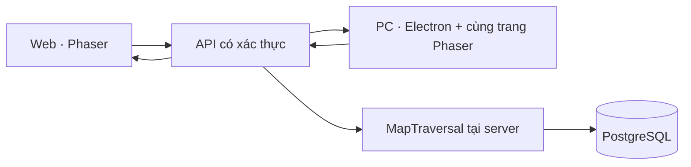

> Map r009: [khối địa hình, Vùng2 và dốc](design/mmorpg-design-checklist-v1/274_BINH_MINH_KHOI_DIA_HINH_VUNG_2_R009.md).

# Ẩn Thành — nền MMORPG dùng chung web và client PC

> Cập nhật271/r006: [Đối chiếu thiết kế và map thật](/design-preview/v01-composition-r006/index.html) · [Hồ sơ](design/mmorpg-design-checklist-v1/271_BINH_MINH_BO_CUC_THEO_ANH_THIET_KE.md). Bố cục toàn vùng theo pin ảnh thiết kế; thay tọa độ cũ, có migration002 và chuyển điểm theo khu, giữ nhân vật/cấp/XP. Nhân vật mới xuất hiện tại2160,2295.

> Cập nhật270: [Map1 theo địa hình và cốt truyện](design/mmorpg-design-checklist-v1/270_MAP_1_DIA_HINH_LANG_RUONG_VA_CUA_HAM.md). Làng nhiều mẫu nhà, gò/vách/bậc, ruộng/mương, vật liệu nước mới và ngoại cảnh ba cửa hầm đã vào bản chơi; NPC/nhiệm vụ chưa triển khai.

> Cập nhật269: [Bố trí cảnh, chuyển động và ba hầm](design/mmorpg-design-checklist-v1/269_BINH_MINH_DUONG_DI_VA_HAM_NGUC.md). Đường bo mép, cây thưa hơn, input có xác nhận/phát lại; ba hầm đã dùng nền/vật thể/collision riêng thay ảnh concept.

24/10/2026. Bình Minh cấp1–10, tách khỏi thủ thành. Cập nhật268: vùng6000×4500, cây có socket riêng và thảm thực vật mới; [hồ sơ hiện tại](design/mmorpg-design-checklist-v1/268_BINH_MINH_CAY_THAM_THUC_VA_MO_RONG.md). TypeScript/Vite và map ghép từđợt266 tiếp tục được dùng.

## Chạy local

1. Chạy `npm run dev`: script hiện có khởi động PostgreSQL local và server cổng3000.
2. Web: http://localhost:3000/mmorpg/index.html . Cần đăng nhập; lần đầu chọn race để tạo nhân vật.
3. PC: nhấp đúp `Choi-An-Thanh.cmd` để bậtserver/PostgreSQL khi cần rồi mởclient mới nhất. EXE trực tiếp: `release/pc-0.2.0/AnThanh-win32-x64/AnThanh.exe`; trang tảiZIP: `/client.html`. Giữ nguyên cácfile đi kèmEXE. [Hướng dẫnPC](CLIENT_PC.md).
4. Phát triển client: `npm run client:dev`. Đóng gói lại Windows: `npm run client:build`.

WASD/mũi tên để đi; F hoặc nút để vào/ra hầm. Map gồm ngoài trời và3không gian dưới đất. Bản thiết kế không đăng nhập/không lưu nằm riêng tại /design-preview/v01-complete-map-r001/index.html; không nhầm các công cụ đó với gameplay account.

## Kiến trúc thực

`src/mmorpg/game.ts` là renderer/input chung của web vàPC, build bằngVite thành `public/mmorpg/client/game.js`. `src/mmorpg/network.ts` quản lý giao tiếp, `world-renderer.ts` ghép cảnh. `src/shared/map-traversal.ts` là nguồn logic vị trí/va chạm duy nhất: TypeScript phát hành JS cho server, Vite dùng cùng nguồn cho client dự đoán. Không sửa fileJS đã sinh. `desktop/main.cjs` chỉ là vỏ client, không có gameplay riêng. Server quyết định trạng thái được ghi; renderer không truy cập PostgreSQL hoặc chứaDATABASE_URL.

Build: `npm run mmo:build` (biên dịchmap → kiểmTypeScript → phát hành logic chung → Vite). Sau khi sửa source, build trước khi chạy/reload. Nếu sửa sharedlogic hoặcTiledmap, khởi động lại server. `npm run mmo:check` chỉ kiểmkiểu. Các dependency phát triển đã pin trongpackage-lock; không thay phiên bảnPhaser ở đợt này.

## PostgreSQL đang lưu gì

Migration001 tạo mmorpg_characters với account_idFK về accounts, tên, race, level, experience, profession, map_id, vị trí, điểm trở về từ hầm, revision, control_hash và timestamp. Tạo ở cấp1,XP0,professionNULL; không lấy level/XP của thủ thành. Bản dựng hiện có một nhân vật chính/account; hệ nhiều slot/chọn nhân vật chưa triển khai.

mmorpg_schema_migrations ghi version/checksum. Migration chạy transaction, advisory lock và kiểm tra checksum; chạy lại không tạo trùng. Không sửa migration đã áp dụng; thay đổi schema tiếp theo phải thêm version mới. Accounts/sessions dùng hệ auth hiện có, không tạo hệ mật khẩu thứ hai.

MMORPG từ chối chạy API nếu backend không phảiPostgreSQL. SQLite fallback phát triển của thủ thành giữ nguyên, không dùng thay cho dữ liệu nhân vật MMORPG.

## API đã hoạt động

| API | Vai trò |
|---|---|
| GET /api/mmorpg/bootstrap | Đọc nhân vật, khôi phục vị trí/map, chỉ đọc trạng thái, không thay phiên điều khiển |
| POST /api/mmorpg/control | Nhận quyền điều khiển mới, kiểm same-origin |
| POST /api/mmorpg/character | Tạo nhân vật chính, kiểm race; idempotent theo account |
| POST /api/mmorpg/input | Nhận dx/dy, sequence và controlToken; server tính chuyển động và ghi DB |
| POST /api/mmorpg/interact | Server kiểm khoảng cách rồi chuyển hầm hoặc trở ra |
| POST /api/mmorpg/dev-place | Mặc định khóa; chỉ hoạt động khi development và MMO_DEV_MAP_TOOLS=1 |

Không có API nhận level/XP/tiền hoặc tọa độ do client tự quyết. Tốc độ lấy từ cấu hình server, delta từ đồng hồ server, giới hạn0.15s mỗi input; kiểm va chạm chia bước. POST kiểm same-origin, kích thước JSON≤1024byte, kiểu/số hữu hạn và sequence tăng. Rate limit trước auth giảm request dồn.

Mỗi POSTcontrol thay control lease; phiên web/PC cũ bị từ chối409. UPDATE có điều kiện account+revision+control_hash; khi CAS thất bại không ghi đè phiên khác. Chỉ trả thành công sau khi PostgreSQL xác nhận UPDATE; DB lỗi phục hồi model trước input và trả503. Vào/ra hầm và điểm trở về được ghi cùng một UPDATE.

Client gửi khoảng10input/s lúc di chuyển, heartbeat1/s lúc đứng yên; không chồng request. Có timeout5s, dừng dự đoán khi mạng lỗi; phiên mất quyền yêu cầu tải lại. DB lưu mỗi input được chấp nhận trong bản đầu; cần tách world tick/batch persistence khi đo tải và triển khai nhiều người, không gọi đây là kiến trúc MMO quy mô lớn đã hoàn thiện.

## Client PC

Client0.2.0 dùngElectron45.0.0, packager20.3.0 pin trongpackage-lock. Renderer nodeIntegration=false, contextIsolation=true, sandbox=true. Preload chỉ expose bridgehẹp trên tranglauncherđónggói, không expose trênwebgame/login; senderframeđược kiểmtra. Chặnpopup, webview và điều hướng khácorigin. Từ chốiHTTP ngoài loopback, online dùngHTTPS. Theo https://www.electronjs.org/docs/latest/tutorial/security .

`desktop/client-config.json` chứaserverOrigin/entry, không chứa mật khẩu. Có thể đặtANTHANH_SERVER_URL hoặcchọnserver bằngF8. Launcher kiểm `/api/client-info`, chỉ lưu máy chủkết nối thành công. F11 toànmànhình; Alt mởmenunative. Trang `/client.html` đọcmanifest và tảiZIPstream, cóphiênbản/dunglượng/SHA-256. Hostpublic, ký số vàinstaller/updater chưa triểnkhai. Client không chứa backend/PostgreSQL hoặc thôngtinDB.

## Map hiện tại

Map ngoài trời hiện làPhaserTilemap400×300ô, mỗiô15worldpixel, vùng6000×4500. Có583cây,3585instance thảm thực vật và cácvật thể khác, tổng4199record gồm2collider lan can. NguồnTiled: `public/mmorpg/maps/binh-minh.tmj`; build tạo `runtime-map.json` cho client/server cùng đọc. Giữgốc tọađộ vàscale3 để tươngthích vịtrí đãlưu. GroundID1cỏ,2đườngđất,3nướcsâu,4deck/sỏi,5nướccạn,6rừngđóng. Cỏ ngoàiđường có thể khámphá; sâu/rừngđóng chặn, cạn giảm tốc0.8. Cây cósocket riêng cho4loài, tán lay quanhđiểm nối. Collider bámchân, depth theo chân và cảthân/tán mờ khiche nhânvật.

Ba hầm vẫn giữ ảnhconcept vàcorridor cũ; không gọi chúng làmapmodule đã hoàn thiện. Tiled hiện cho chỉnh dữ liệu nền, pointobject vàwidth; ảnhprops chưa hiển thị trực tiếp trongeditor. Mỹ thuật bờ sông, bố cục và biến thểcông trình còn cần cải thiện.

Avatar hiện dùng human proxy cho cảrace để kiểm input; không coi bộ avatar hoàn tất. Không combat, quest, inventory, wallet hoặc multiplayer/AOI trong bản dựng này. Những hệ đó cần migration/API riêng khi triển khai thực, không tạo bảng trống để báo hoàn thành.

## Kiểm chứng

- test/mmorpg-map.test.mjs: spawn/portal/landmark, nước sâu và giá trị không hợp lệ, vòng vào-ra3hầm, không xuyên vách khi bước lớn.
- test/mmorpg-modular-map.test.mjs: sourceTiled/runtime khớp, đường tới toàn bộmốc/cửa hầm có kiểm từngđoạn, sâu/cạn/cỏ, footprint/rails và diện tích mới giữ tọa độ cũ. Tổng10test map đạt ở đợt268.
- public/mmorpg/assets/modular-qa.json:12kiểm tra clientmap và phímF đi/ra hầm thật; sốnode trước/sau không tăng, khôngpageerror. Đây không phải benchmarkFPS hoặc tảiMMO.
- mmorpg-db-qa.json: dùng account tạm trên PostgreSQL thật, tạo nhân vật, level1, lưu vị trí/reload, lưu trong hầm và trở về, chặn lease cũ/input sai/devwarp, yêu cầu login. Dữ liệu QA đã xóa.
- mmorpg-client-qa.json: chạy chính release/AnThanh-win32-x64/AnThanh.exe trong cửa sổ QAẩn; login bắt buộc, Phaser chạy, packaged=true và renderer sandbox/isolation đúng; không pageerror.
- Web và client dùng chung server/data. Chưa kiểm thử tải nhiều người, mất kết nối dài, backup/restore vận hành hoặc production HTTPS.
