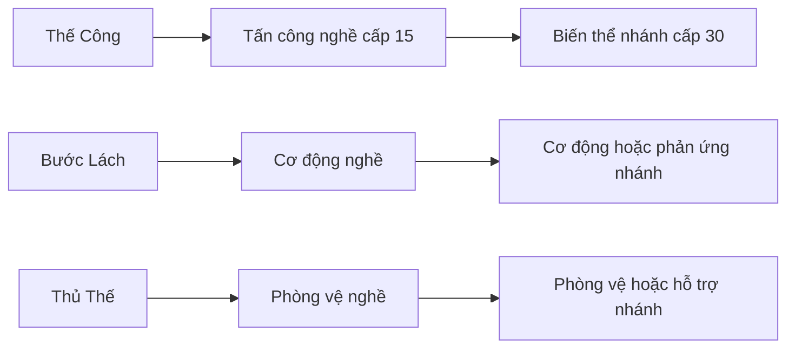

> **Điều chỉnh nhân vật có hiệu lực · 22/10/2026:** [Hồ sơ 208](208_DIEU_CHINH_NHAN_DIEN_VU_KHI_VA_HGD_DI_BO.md) thay các mô tả xung đột: HGD dùng kỹ năng khi đi bộ; VAN giáo + khiên; PRI thánh thư + trượng chữ thập; xạ thủ Người Lùn dùng nỏ/bẫy; có trang bị mũ. PAL/DKN vẫn cần ngựa. Ảnh là 2D pixel cho thế giới 2.5D.

> **Bổ sung có hiệu lực · 21/10/2026:** [Bộ20hồ sơ V1](125_BAO_CAO_20_MUC_COMBAT_SKILL.md) và [catalog126](126_DANH_MUC_KY_NANG_V1.md) hoàn thiện kit/rank/talent/hồi sinh/lifecycle. Thay các trường còn để mở hoặc mô tả cũ khi xung đột; giữ cap60/nội dung45, V01khôngquái bay,35SP/11TP và hotbar13. Đây là thiết kế, chưa game/asset chạy được.

> **Cập nhật có hiệu lực · 21/10/2026:** [Thanh 13 ô hỗn hợp](64_HOTBAR_13_O_KY_NANG_VAT_PHAM.md) thay cấu trúc tám ô/ô bắt buộc bên dưới: 1–9,Q,E,R,Z, kéo kỹ năng hoặc vật phẩm tiêu thụ; giữ WASD + con trỏ. Số lượng/cooldown không nhân theo shortcut. Các đoạn cấu trúc cũ chỉ còn lịch sử khi xung đột.

# Hệ kỹ năng — tân thủ, tiến hóa chức nghiệp và vô môn

**Phiên bản:** 1.0 · **Ngày:** 21/10/2026  
**Trạng thái:** Đã thiết kế kiến trúc và ý tưởng; chưa hoàn thiện bảng số, bộ kỹ năng của 19 nhánh hoặc animation. Thiết kế UI cơ chế đã có tại hồ sơ 31.  
**Nguồn:** ý tưởng chủ dự án; trợ lý hoàn thiện quy tắc theo ủy quyền.  
**Đầu vào:** [Hệ chủng tộc/nghề](28_HE_CHUNG_TOC_CHUC_NGHIEP_TRANG_BI.md), chuyển chức 15, chuyên sâu 30, cap 45, phong cách V4.

## 1. Cấu trúc tân thủ

Trước cấp 15 chưa có chức nghiệp. Vì vậy phần người dùng gọi “kỹ năng class tân thủ” được diễn giải là **kỹ năng chủng tộc**. Đây là lựa chọn thiết kế để khớp mô hình mới, không phải chọn nghề ngầm từ cấp 1.

Bộ hoàn chỉnh trước chuyển chức:

- **3 chủ động nền + 1 bị động nền**, mọi race đều có.
- **1 chủ động race + 3 bị động race**, theo Con Người/Elf/Người Lùn.
- Tổng **4 chủ động, 4 bị động**, ngoài đánh thường và thao tác tương tác.

Mở dần theo tiến trình; không đưa cả tám kỹ năng vào phút đầu. Các nguồn đều nằm trong ngân sách sức mạnh đã có: race thuộc nền nhân vật, skill nghề/nhánh/vô môn thuộc quỹ kỹ năng hoặc nguồn được khai báo; không tự thêm một quỹ cộng chỉ số vô hạn.

## 2. Năm tầng kỹ năng

| Tầng | Mục đích | Khi chuyển chức |
|---|---|---|
| Nền | Học tấn công, cơ động, phòng thủ và sinh tồn. | Ba chủ động tiến hóa theo dòng; bị động nền chuyển thành nền tảng nghề. |
| Chủng tộc | Đặc tính và công cụ cá nhân. | Giữ quyền sở hữu sau 15/30, không cấp lại thành lợi ích cộng dồn. |
| Chức nghiệp | Lối chơi và tài nguyên từ cấp 15. | Kế thừa hoặc đổi form phù hợp nhánh ở 30. |
| Nhánh | Cơ chế bản sắc, hướng build từ cấp 30. | Chỉ nhánh hiện hành, không học lẫn toàn bộ cây. |
| Vô môn | Tiện ích và lựa chọn chung cho mọi nghề. | Giữ kỹ năng đã học, giới hạn số mang theo. |

Đa dạng đến từ biến thể, đánh đổi và phối hợp, không phải bấm hàng chục kỹ năng cùng lúc.

## 3. Ba chủ động và một bị động nền

| Mã biên tập | Tên | Chức năng | Ràng buộc |
|---|---|---|---|
| FND-A | **Thế Công** | Một đòn chủ động có chuẩn bị: kiếm tập quét ngắn, cung tập bắn mạnh, trượng tập phóng xung lực. | Ba cách thể hiện của cùng dòng, không học thành ba cooldown riêng. Trượng tập chưa mặc định nguyên tố nhánh. |
| FND-B | **Bước Lách** | Dịch chuyển ngắn theo hướng nhập để rời nguy hiểm. | Không xuyên tường, sông sâu hoặc miễn mọi damage. |
| FND-C | **Thủ Thế** | Chuẩn bị phòng vệ trong cửa sổ ngắn. | Không bắt có khiên; không bất tử hoặc miễn mọi khống chế. |
| FND-P | **Nền Tảng Sinh Tồn** | Hỗ trợ hồi phục ngoài combat để tiếp tục khám phá. | Dừng khi vào combat; không tự hồi sinh hoặc thay healer trong boss. |

Đánh thường vẫn riêng, theo vũ khí hợp lệ. Bước Lách là công cụ cơ động nền; nếu gán Space thì không đồng thời có một né miễn phí khác cũng dùng Space. INPUT/COMBAT chốt phím, va chạm và việc tránh đòn thực tế.

Damage, cost, cooldown, thời gian niệm/thu hồi và điều kiện cụ thể cần đặc tả SKILL-04/STAT. Tên kỹ năng không tự là công thức đã cân bằng.

## 4. Bộ kỹ năng chủng tộc

Mục tiêu: lợi thế nhỏ và công cụ bổ sung, không tạo race bắt buộc cho mọi DPS/healer. Mỗi race có một chủ động và ba bị động, không nhận lại bộ mới mỗi lần thăng nghề.

| Race | Chủ động | Ba bị động |
|---|---|---|
| **Con Người** | **Chấn Chỉnh Ý Chí:** ổn định bản thân, hỗ trợ phục hồi tài nguyên cá nhân trong một cửa sổ ngắn. | **Sức Bền Đường Xa:** hồi sức di chuyển ngoài combat. **Tinh Thần Vững:** kháng một nhóm bất lợi tinh thần xác định. **Ứng Biến:** phòng vệ nhỏ khi nguy cấp, có hồi nội tại. |
| **Elf** | **Điều Tức:** hỗ trợ nhịp di chuyển/quản lý tài nguyên ngắn hạn, không xóa aggro hoặc tàng hình. | **Bước Chân Nhẹ:** giảm tác động một nhóm làm chậm. **Cảm Nhận Linh Mạch:** gợi ý tương tác đã gần. **Nhịp Thở Tự Nhiên:** hồi phục ngoài combat, vẫn hữu ích ngoài rừng. |
| **Người Lùn** | **Trụ Vững:** tăng ổn định trước đẩy/lùi trong thời gian ngắn, không miễn choáng hoặc vùng chết. | **Chân Trụ:** giảm displacement theo quy tắc chung. **Thân Thể Bền Bỉ:** kháng một nhóm trạng thái cơ thể xác định. **Bền Chí:** phòng vệ nhỏ khi nguy cấp, có hồi nội tại. |

Kháng tinh thần/thể chất phải map vào catalog trạng thái cụ thể, không có “kháng tất cả”. Trụ Vững/Chân Trụ cùng nhóm cộng có giới hạn; các hiệu ứng nguy cấp có hồi nội tại, không kích hoạt liên tục bằng tự gây hại.

Cảm nhận Elf chỉ gợi ý, không mở rương hoặc manh mối độc quyền; race khác vẫn khám phá bằng dấu vết. Không cấp may mắn, XP, tiền hoặc nới cap theo race. Chưa đặt con số cho trait trước khi có bảng cân bằng chung.

## 5. Nhịp mở trước và sau chuyển chức

| Mốc | Mở thêm |
|---|---|
| Cấp 1 | Đánh thường, Thế Công, Nền Tảng Sinh Tồn. |
| Cấp 3 | Bước Lách, bị động race thứ nhất. |
| Cấp 5 | Chủ động race. |
| Cấp 7 | Thủ Thế. |
| Cấp 9 | Bị động race thứ hai. |
| Cấp 12 | Bị động race thứ ba; hoàn chỉnh bộ 4 chủ động/4 bị động. |
| Chuyển chức 15 | Ba dòng chủ động tiến hóa; một chủ động nghề mới; bị động nghề lõi. |
| Cấp 18 | Có thể học một vô môn nhập môn qua nhiệm vụ. |
| Chuyên sâu 30 | Ba dòng đổi form theo nhánh; mở công cụ bản sắc và bị động nhánh. |

Cấp là điều kiện mở quyền, không tự hoàn thành nhiệm vụ chuyển chức. Nhân vật qua 15 nhưng chưa chọn nghề vẫn dùng bộ tân thủ. Quest/XP phải không đòi kỹ năng chưa học: M02 dùng di chuyển thường để tránh nếu chưa có Bước Lách, không tự cấp kỹ năng trái mốc.

## 6. Tiến hóa theo dòng

Mỗi dòng có ID ổn định, form hiện hành và phần đầu tư hợp lệ. Tiến hóa mở form mới, giữ đầu tư cùng dòng; không phát thêm điểm hoặc copy rank từ kỹ năng không liên quan. Form cũ chỉ xem trong thư viện, không dùng song song để lấy cooldown thứ hai.

Nếu điểm/rank không chuyển 1:1, phải có bảng chuyển đổi và preview. Không mặc định mất hết kỹ năng khi đổi nghề. Bị động nền chuyển thành nền tảng nghề phù hợp, không cộng đồng thời bản cũ/mới; mọi vai trò vẫn có công cụ hồi phục ngoài combat hợp lý.

### Ba dòng rẽ theo bảy nghề

| Nghề | Từ Thế Công | Từ Bước Lách | Từ Thủ Thế | Một chủ động nghề mới |
|---|---|---|---|---|
| Kỵ Sĩ | Phá Thế | Bước Xung Kích | Thế Bảo Hộ | Hiệu Triệu — bảo hộ có giới hạn. |
| Chiến Binh | Hoành Kích | Bước Tiến Công | Gồng Thế | Chiến Ý — cửa sổ tăng áp lực, có tài nguyên/đánh đổi. |
| Kiếm Sư | Kiếm Kích | Lướt Kiếm | Phản Thế | Định Tâm — chuẩn bị combo. |
| Pháp Sư | Pháp Kích | Bước Ma Lực | Màn Chắn | Hội Tụ — chuẩn bị phép/quản lý tài nguyên. |
| Cung Thủ | Xạ Kích | Bước Lùi Chiến Thuật | Thế Cảnh Giác | Đánh Dấu — công cụ của kit, không auto cấp loot cả đội. |
| Tinh Linh | Linh Kích | Bước Dẫn Linh | Linh Hộ | Gọi Linh Thể — đơn vị mẫu có lệnh cơ bản. |
| Mục Sư | Tín Niệm Kích | Bước An Toàn | Lời Bảo Hộ | Chữa Trị — hồi phục thật, không hồi sinh. |

Tên là tên làm việc. Mục Sư Con Người có biểu hiện thần thánh, Elf có nghi lễ thiên nhiên; không ép Elf thờ thần theo ngoại hình Con Người hoặc đổi chỉ số chỉ vì đổi ảnh. Mỗi nghề có một bị động lõi, ngoài lựa chọn talent về sau; không mở lại ba bị động race như phần thưởng nghề.

### Ví dụ chuyên sâu cấp 30

| Nhánh | Dòng tấn công | Dòng cơ động | Dòng phòng vệ | Ý tưởng skill bản sắc |
|---|---|---|---|---|
| Thánh Kỵ Sĩ | Thánh Trảm | Bước Thệ Ước | Bảo Hộ Thánh | Kỹ năng bản sắc chủ động cần thiết kế lại; Thiên Mã chuyển thành bị động tiến hóa ngựa theo hồ sơ 34. |
| Hắc Kỵ Sĩ | Hắc Trảm | Bước Ám Kỵ | Hắc Giáp | Kỹ năng bản sắc chủ động cần thiết kế lại; chiến mã hắc ám là tư thế nền/bị động theo hồ sơ 34. |
| Hộ Vệ Thánh | Chùy Trấn | Bước Chắn | Khiên Bảo Hộ | Phạm vi bảo hộ đội. |
| Tiên Phong | Đâm/Quét Giáo | Xung Phong | Giữ Trận | Tạo tuyến áp lực, không khóa đường cả map. |
| Cuồng Chiến | Bổ Rìu | Lao Chiến | Gồng Cuồng Ý | Cửa sổ bùng nổ có đánh đổi. |
| Phong Kiếm Khách | Phong Trảm | Phong Bộ | Phản Phong | Trận gió/kiếm ý phục vụ combo. |
| Sát Thủ | Song Đao | Ảnh Bộ | Ẩn Mình | Kết liễu hoặc lướt chém, có điều kiện lộ/tương tác. |
| Pháp Sư Tử Linh | Tử Ấn từ sách | Bước Vọng Linh | Cốt Hộ | Lệnh đồng hành tử linh, có hạn mức/quyền proc. |
| Mục Sư | Đòn thánh đủ solo | Bước An Toàn chuyên sâu | Hào Quang Bảo Hộ | Hồi phục/cứu nguy có chi phí, không tự hồi sinh. |
| Pháp Sư Mộc | Mộc Kích | Bước Sinh Trưởng | Vỏ Cây | Mầm Sinh Lực — hồi phục thiên nhiên. |

Đây là ví dụ cách phân hóa, chưa phải mười kit hoàn chỉnh hoặc thay danh sách 19 nhánh. Nhánh nguyên tố phải thay ứng xử/đánh đổi, không copy cả damage/cooldown rồi chỉ đổi màu. Cung Thủ/Tinh Linh giữ tên nghề vẫn có form chuyên sâu và bản sắc riêng.

## 7. Loadout: học rộng, mang có giới hạn

| Giai đoạn | Chủ động mang theo tối đa | Cấu trúc |
|---|---:|---|
| Trước 15 | 4 | 3 nền + 1 race. |
| 15–17 | 5 | 3 dòng nghề + 1 chủ động nghề mới + 1 race. |
| 18–29 | 6 | Như trên + 1 slot linh hoạt nghề/vô môn. |
| 30–45 | 8 | 3 dòng nhánh + 1 skill nghề + 1 skill bản sắc nhánh + 1 race + 2 slot linh hoạt. |

Tối đa **một chủ động vô môn trước 30**, **hai từ 30**; chúng dùng slot linh hoạt, không lách vào ba slot dòng lõi. Thư viện có thể học nhiều hơn số mang nhưng không cast kỹ năng ngoài loadout bằng API.

Đánh thường, tương tác và thuốc là nhóm riêng. Lệnh pet điều khiển entity, không thành thanh kỹ năng damage/cooldown phụ miễn phí ngoài kit. Cơ chế AI/skill pet vẫn phải được hạch toán sức mạnh.

Ba passive race tự áp dụng khi đủ điều kiện. Passive nền/nghề/nhánh lõi chỉ áp một form hợp lệ. **Ba slot thiên phú tùy chọn** mở ở 15/22/30; tối đa một passive vô môn trong ba slot. Không cộng tất cả passive đã học trong thư viện.

Đổi loadout ngoài combat tại điểm nghỉ, không reset cooldown hoặc tạo thêm tài nguyên. Buff/pet/field của skill tháo khỏi loadout phải có chính sách chấm dứt/duy trì rõ; không cho đổi liên tục để giữ mọi buff. Đổi loadout không đồng nghĩa được đổi nghề/nhánh.

## 8. Rank, tiến hóa và biến thể

- **Rank:** mức đầu tư kỹ năng. Chọn năm rank chung cho một dòng, trần theo cấp nhân vật ở mốc 1/8/15/25/35 tương ứng 1/2/3/4/5. Đạt mốc chỉ mở quyền nâng, không tự nâng hoặc làm mọi kỹ năng mới đạt max.
- **Tiến hóa:** đổi form của cùng dòng ở chuyển chức 15/30; giữ đầu tư tương thích, không reset thành phần thưởng lặp.
- **Biến thể:** chọn cách dùng có đánh đổi: rộng hơn nhưng chậm, đơn mục tiêu mạnh nhưng ít lan, cơ động ngắn nhưng dễ hồi. Không cộng mọi biến thể cùng lúc.
- Trước 30 chọn tối đa một biến thể/dòng; từ 30 có thể thêm điểm điều chỉnh thứ hai nếu đã có tổ hợp tương thích. Không ghép mô-đun bất kỳ của mọi nghề.
- Nâng rank chắc chắn khi đủ điều kiện/điểm, không roll thất bại bằng đá ngẫu nhiên. Nguồn điểm và chi phí rank dùng hồ sơ 31; hiệu quả mỗi rank vẫn cần thiết kế theo từng kỹ năng.
- Reset phải preview quyền giữ/hoàn điểm, không phát lại quà học lần đầu hoặc mở skill nhánh khác.

Mức trần rank, nguồn 35 SP và 11 TP tại cấp 45 cùng chi phí nâng đã được chốt trong hồ sơ 31. SKILL-05 vẫn một phần vì thiếu bảng hiệu quả cụ thể. Không áp hệ rank này vào thủ thành.

## 9. Kỹ năng vô môn

Vô môn không yêu cầu nghề/nhánh/race, nhưng vẫn có cấp, nhiệm vụ/thầy dạy, tài nguyên và trạng thái. Không khóa truyện bắt buộc sau một sách hiếm. Các kỹ năng nền mặc định không được học lại dưới tên vô môn để lấy cooldown thứ hai.

| Ý tưởng | Loại | Công dụng | Giới hạn |
|---|---|---|---|
| Băng Bó | Chủ động | Tự hồi phục khi không bị áp lực. | Chuẩn bị/có thể bị ngắt; không thay heal combat Mục Sư. |
| Tịnh Tâm | Chủ động | Phục hồi tài nguyên ngoài combat. | Không trao đổi HP/tài nguyên thành vòng lặp vô hạn. |
| Thanh Tẩy Sơ Cấp | Chủ động | Gỡ một nhóm độc/chậm cơ bản. | Không gỡ mọi CC hoặc cơ chế boss. |
| Hỏa Cụ Dã Chiến | Tiện ích | Thắp sáng/đốt vật thể quest được phép. | Không phá mọi cửa; damage phụ nếu có phải cân. |
| Dây Móc Thám Hiểm | Tiện ích | Qua điểm móc do map cho phép. | Không tự do bay qua map hoặc dùng né cơ chế boss. |
| Cắm Trại | Tiện ích | Chuẩn bị ngoài combat ở chỗ phù hợp. | Không sinh XP/tiền/nguyên liệu bằng đặt/hủy. |
| Sơ Cứu | Passive tùy chọn | Hỗ trợ hiệu quả item hồi phục. | Chiếm slot thiên phú, không proc heal vô hạn. |
| Quan Sát | Passive tiện ích | Làm rõ dấu vết tương tác đã gần. | Không độc quyền rương, tăng drop hoặc vượt cap. |

Đề xuất lô đầu **Băng Bó / Thanh Tẩy Sơ Cấp / Quan Sát** để thử ba hướng. Các ý tưởng còn lại là backlog, không cam kết có hết ngay.

Không có vô môn phiên bản đầy đủ của thiên mã, quân đoàn tử linh, triệu hồi chủ lực hoặc toàn bộ heal Mục Sư. Không bán skill sức mạnh độc quyền người nạp. Nhánh nào cũng được học vô môn hợp lệ, nhưng không bỏ qua ràng buộc vũ khí/địa hình/trạng thái của chính kỹ năng đó.

## 10. Làm 19 nhánh sâu trước khi thêm thật nhiều nhánh

Mỗi nhánh cần bản sắc về tài nguyên, nhịp đòn, cách sống sót/cơ động, vai trò solo/nhóm và hình hành động. Hai hướng build nội bộ bằng talent/biến thể thường đáng làm hơn thêm một nhánh mới chỉ khác màu.

Ví dụ: Cuồng Chiến dồn lực/duy trì; Cung Thủ đơn mục tiêu/kiểm soát đường bắn; Tinh Linh một đồng hành chủ lực/nhiều đơn vị nhỏ có hạn mức; Tử Linh đội xương/ấn và hiến đổi có tài nguyên. Không coi những gợi ý này là đã có toàn bộ kit.

### Những nhánh mở rộng đáng cân nhắc

Các dòng sau chỉ là đề xuất tương lai, **không thêm vào 19 nhánh/28 tổ hợp hiện hành**.

| Nhánh đề xuất | Nghề/race cân nhắc | Vai trò mới | Phụ thuộc/đánh đổi |
|---|---|---|---|
| Phù Văn Sư | Pháp Sư / Người Lùn | Kết giới, dấu ấn, bảo hộ. | Cần khác Thổ, có quy tắc field/buff/stack rõ. |
| Vệ Binh Phù Văn | Chiến Binh / Người Lùn | Đỡ áp lực và hỗ trợ đội bằng rune. | Không mở Kỵ Sĩ ngầm; cần kit phòng vệ riêng. |
| Xạ Thủ Cơ Giới | Cung Thủ / Người Lùn | Nỏ/cơ khí, nhịp nạp lại. | Họ vũ khí/animation/tài nguyên mới, không đổi ảnh cung thành nỏ. |
| Linh Thú Sư | Tinh Linh / Elf hoặc Con Người | Đồng hành động vật, lệnh phối hợp. | AI/path/aggro và ownership, không chỉ thay ảnh linh thể. |
| Nguyệt Tiễn | Cung Thủ / Elf | Nhịp ngắm, dấu và đường tên có ma thuật. | Không giỏi mọi loại damage hơn cả cung lẫn pháp. |
| Thẩm Phán | Mục Sư / Con Người | Thanh tẩy/tấn công hỗ trợ. | Không đồng thời heal và damage tốt nhất. |

Ưu tiên nghiên cứu Phù Văn Sư/Vệ Binh Phù Văn nếu Người Lùn thực sự thiếu hướng hỗ trợ đội; sau đó Xạ Thủ Cơ Giới nếu đủ ngân sách. Không thêm để mỗi race có bản sao của mọi nghề. Không hứa hệ hoàn hảo trước kiểm chứng người chơi và chi phí sản xuất.

## 11. Kiến trúc dữ liệu và hiệu ứng

Mỗi skill có ID, nguồn, lineage/form, quyền học/rank, vũ khí/slot, target, range/hitbox, các pha, cost/cooldown/charge, cancel/interruption, tác động/proc, animation/VFX/SFX, version và quy tắc chuyển đổi.

Dùng catalog tác động chung: direct hit, projectile, area, heal, shield, dash, summon, buff, cleanse. Không để mỗi lần đánh tạo timer không kiểm soát hoặc mỗi skill chèn mã tùy ý; cũng không dựng một ngôn ngữ scripting phức tạp trước khi có nhu cầu.

Damage lan/DoT/pet quy định quyền kích hoạt, người được ghi công, khả năng crit/ngọc và giới hạn. Tử Linh/Tinh Linh có hạn mức/AI/thay thế rõ, không lấy số hình đã vẽ quyết định số pet vô hạn.

Server quyết định quyền học, loadout, vũ khí và kết quả combat. PostgreSQL lưu skill đã học, rank đầu tư, form mở, biến thể/preset; client không tự xác nhận đã tiến hóa. Chuyển form/hoàn điểm/quà học có giao dịch nhất quán và chống xử lý trùng; đổi preset/logout không reset cooldown.

## 12. Cửa sổ kỹ năng

Năm tab: **Nền Tảng / Chủng Tộc / Chức Nghiệp / Nhánh / Vô Môn**. Mỗi dòng nền hiện đường tiến hóa 15/30, form hiệu lực và nhánh biến thể, không bắt nhớ ba tên rời để biết cùng dòng.

Tooltip phân biệt rank/tiến hóa/biến thể, quyền vũ khí, target, cost, cooldown, điều kiện khóa và số hiệu lực. Preview chuyển chức chỉ rõ cái giữ/đổi/hoàn lại. Hotbar chỉ cast loadout thật, skill thư viện không mang không được gọi trực tiếp qua API.

INPUT chốt phím và số hàng hiển thị; không sao chép nguyên Q/E/R thủ thành. Kéo đổi vị trí/bind không thay quyền slot. Lệnh triệu hồi được thiết kế cùng độ phức tạp bộ kit, không bất ngờ thêm mười phím bắt buộc.

## 13. Tình huống biên và bàn giao

- Đổi bộ tập không có ba Thế Công/cooldown riêng.
- Chuyển 15/30 giữ đầu tư cùng dòng, không cast thêm bản cũ hoặc cộng passive hai lần.
- Tháo preset không giữ mọi buff/pet hoặc reset cooldown để lợi dụng.
- Gợi ý khám phá theo race/vô môn không tạo manh mối hoặc rương độc quyền ngoài chủ đích.
- Vô môn không bỏ qua vũ khí, trạng thái hoặc cơ chế boss.
- Nhiều người cùng buff/proc dùng hệ effect chung có giới hạn và attribution.
- Đạt cấp 30 không mở mọi nhánh, mọi rank hoặc mọi skill vô môn cùng lúc.

Đã thiết kế khung và ví dụ; nguồn điểm, giá nâng rank và wireframe có trong hồ sơ 31. Chưa có bộ số từng kỹ năng, đủ 19 bộ nhánh hoặc kiểm thử. SKILL-03/05/06 là **thiết kế một phần**; SKILL-08 hoàn thiện thiết kế cơ chế, chưa triển khai.

Khi tiếp tục chi tiết, ưu tiên chốt bộ nền và một kit nghề/nhánh đại diện có đủ thông số để kiểm chứng pipeline, sau đó mở các bộ khác. Công việc này không xóa thứ tự ART-03 đang cần mở rộng nhận diện toàn cây mới trước ART-04.

## 14. Cập nhật bảng kỹ năng sau nghiên cứu · 21/10/2026

[Hồ sơ31](31_BANG_KY_NANG_VA_PHAN_DIEM.md) chốt nguồn35SP/11TP ở45, chi phí nângrank1/1/2/2, hai preset miễn phí từ15, reset rank/talent miễn phí tại điểm nghỉ, bản nháp/Áp dụng córevision và nhóm quyền/slot. Rank chỉ tiêuSP ở các dòng có khai báo; traitrace/passive lõi mở tự động và talent một bậc không tiêuSP. Những mô tả trước để mở nguồn điểm/reset được thay bởi quyết định này, sốdamage/costtừngskill vẫn ởtaskchi tiết.

SKILL-08 đã hoàn thiện thiết kế cơ chế UI; SKILL-03/05/06 vẫn một phần. Nghiên cứu tham khảo không đồng nghĩa đã kiểm thử game.

## Đồng bộ liên hệ thống · 21/10/2026

[Hồ sơ 32](32_DONG_BO_CLASS_KY_NANG_TRANG_BI.md) bổ sung quy tắc có hiệu lực: SP dùng được cho dòng tân thủ; tiến hóa mặc định kế thừa 1:1; số ô nghề/nhánh cần hoàn thành chuyển chức; quyền vũ khí nhánh không cộng dồn quyền nghề cha; biến thể TP và bị động cần ô được phân biệt rõ. Khi có mô tả khái quát chưa đủ điều kiện trong hồ sơ này, áp dụng phần chi tiết hồ sơ 32.

## Cập nhật Kỵ Sĩ chiến đấu trên ngựa · 21/10/2026

[Hồ sơ 34](34_KY_SI_CHIEN_DAU_TREN_NGUA.md) có hiệu lực thay mô tả cưỡi cũ: nghề Kỵ Sĩ và hai nhánh Thánh/Hắc dùng kỹ năng nghề/nhánh khi cưỡi ngựa chiến; Hộ Vệ Thánh được dùng kỹ năng khi đi bộ, chỉ dùng họ ngựa. Thánh/Hắc có giáp ngựa suy ra từ đồ đang mặc và bị động tiến hóa cánh theo từng con ngựa; không còn lấy lên ngựa làm chiêu cuối tạm thời. Nghề khác cưỡi để di chuyển, không chiến đấu trên thú. Quy tắc vùng, quyền kỹ năng và lớp hình xem hồ sơ 34; chưa triển khai.

## Bổ sung nội tại chủ đạo theo nhánh · 21/10/2026

[Hồ sơ78](78_NOI_TAI_CHU_DAO_CUA_19_NHANH.md) thêm profile chuyển hóa một/hai thuộc tính cho19nhánh. Lợi ích gốc vẫn giữ; AP + flat root từ gear hợp lệ tạo R giảm dần, bonus đi vào nhóm damage/heal/shield/pet đã quy định, không tự nhân stat vòng lặp. Mở cùng nội tại nhánh ở30, không chiếm13ô hoặc ba ô passive tùy chọn. Hệ số là cấu hình thử, không hoàn thiện bộ kit/cân bằng.
