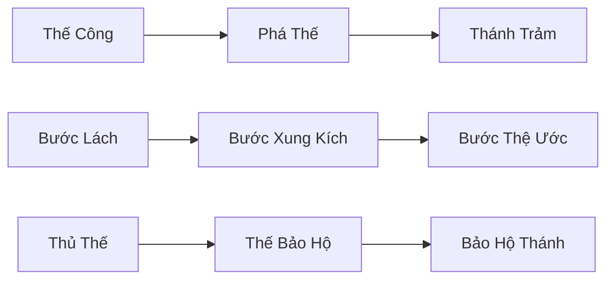
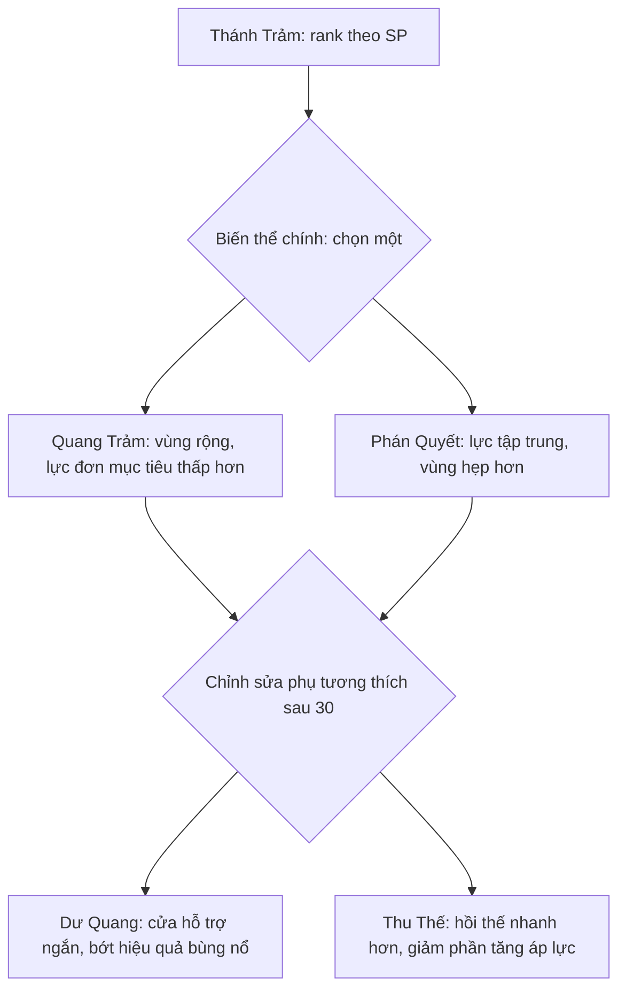

> **Bổ sung có hiệu lực · 21/10/2026:** [Bộ20hồ sơ V1](125_BAO_CAO_20_MUC_COMBAT_SKILL.md) và [catalog126](126_DANH_MUC_KY_NANG_V1.md) hoàn thiện kit/rank/talent/hồi sinh/lifecycle. Thay các trường còn để mở hoặc mô tả cũ khi xung đột; giữ cap60/nội dung45, V01khôngquái bay,35SP/11TP và hotbar13. Đây là thiết kế, chưa game/asset chạy được.

> **Cập nhật có hiệu lực · 21/10/2026:** [Thanh 13 ô hỗn hợp](64_HOTBAR_13_O_KY_NANG_VAT_PHAM.md) thay cấu trúc tám ô/ô bắt buộc bên dưới: 1–9,Q,E,R,Z, kéo kỹ năng hoặc vật phẩm tiêu thụ; giữ WASD + con trỏ. Số lượng/cooldown không nhân theo shortcut. Các đoạn cấu trúc cũ chỉ còn lịch sử khi xung đột.

# Bảng kỹ năng Ẩn Thành — cây tiến hóa, phân điểm và bộ mang theo

**Phiên bản:** 1.0 · **Ngày:** 21/10/2026  
**Trạng thái:** Hoàn thiện thiết kế cơ chế cửa sổ SKILL-08; chưa triển khai trong gameplay. Các kit, bảng damage/cost, điểm cân bằng từng node và ART vẫn có task riêng.  
**Cơ sở:** [nghiên cứu nguồn chính thức](30_THAM_KHAO_BANG_KY_NANG_MMORPG.md), [khung kỹ năng](29_HE_KY_NANG_TAN_THU_TIEN_HOA_VO_MON.md), race/chuyển nghề cấp 15, chọn nhánh cấp 30 và trần cấp 45, phong cách V4.

## 1. Cấu trúc ba lớp

**Cây tiến hóa** trả lời tôi học gì và sẽ tiến thành gì. **Thiên phú** trả lời tôi chọn hướng dùng thế nào. **Bộ mang theo** trả lời skill nào thực sự được dùng lúc này.

Đã học ≠ đã đầu tư cao ≠ đang mang ≠ đang có hiệu lực. Một node không hoạt động không bị xóa khỏi thư viện; không cộng passive từ mọi preset. Phân biệt Nhánh chức nghiệp (chọn 30) và Hướng build nội bộ (đổi ở điểm nghỉ), không gọi cả hai chung là nhánh khiến người chơi nghĩ đổi build là đổi nghề.

## 2. Mở/đóng và bố cục

Phím mặc định đề xuất **K**, gán lại được; menu luôn có nút Kỹ Năng. Chat/ô nhập focus thì K là ký tự. Esc đóng tooltip/popup trước, rồi xử lý cửa sổ; ~ đóng theo quy tắc cửa sổ chung nhưng không âm thầm áp dụng/hủy bản nháp có điểm.

Không pause thế giới. Trong combat có thể xem dạng gọn, không được đổi rank/build/preset; bảng lớn mở ở chỗ an toàn là luồng khuyến nghị.

| Khu | Nội dung |
|---|---|
| Header | Tên/race/nghề/nhánh/cấp, SP/TP khả dụng, tên preset và trạng thái bản nháp. |
| Điều hướng trái | Nền Tảng / Chủng Tộc / Chức Nghiệp / Nhánh / Vô Môn; lọc đã học/có thể học/khóa và tìm tên/tag. |
| Trung tâm | Cây theo nguồn đang chọn; chế độ Cây Tiến Hóa hoặc Thiên Phú. Chỉ tải khu đang xem, không đưa toàn 19 nhánh vào một tấm. |
| Panel phải | Chi tiết node đang chọn, điều kiện, rank hiện tại→dự kiến, số hiệu lực, vũ khí/slot, biến thể và thao tác. |
| Chân cửa sổ | Bộ chủ động, ba ô thiên phú tùy chọn, phím hiện tại, tóm tắt thay đổi; Hoàn tác / Hủy bản nháp / Áp dụng. |

1080p dùng ba cột. 1366×768 thu điều hướng thành rail, panel chi tiết mở theo ngữ cảnh, cây cuộn ngang/dọc trong vùng riêng; nút Áp dụng luôn thấy. Chữ/UI scale độc lập camera; không dùng font pixel khó đọc dấu Việt. Chưa chốt kích thước UI cố định thành luật combat.

## 3. Cách vẽ node và đường nối

| Loại | Hình viền | Nội dung |
|---|---|---|
| Chủ động | Vuông | Icon, tên ngắn, rank và biểu tượng đang gắn slot. |
| Bị động/thiên phú | Tròn | Icon và dấu Hiệu lực/Chưa kích hoạt. |
| Tiến hóa cấp 15/30 | Hình thoi | Mốc chuyển chức, form cũ→mới, không nhầm tăng rank. |
| Lựa chọn loại trừ | Cặp A/B có thanh nối | Chỉ một lựa chọn có hiệu lực trong nhóm, preview đánh đổi. |

Dùng chữ/ký hiệu ngoài màu: Khóa, Có thể học, Đã học, Đang mang, Bản nháp, Không hợp vũ khí, Form cũ, Chỉ xem kế hoạch. Icon khóa có điều kiện rõ, không chỉ mờ đi.

Đường liền: yêu cầu bắt buộc; đường đứt: tiến hóa tương lai; dấu nối cặp: loại trừ. Không vẽ đường dây trang trí khiến người chơi tưởng phải max một skill không liên quan để học skill họ cần.

## 4. Cây tiến hóa xuyên nghề

Mỗi dòng nền là một hàng ngang có ba mốc: Tân Thủ → Nghề 15 → Nhánh 30. Chọn node sẽ hiện lịch sử và form tương lai phù hợp race/nghề, không cho cast form chưa mở.

Ví dụ Con Người/Kỵ Sĩ/Thánh Kỵ Sĩ:

Độ đầu tư cùng lineage giữ theo bảng chuyển đổi; form cũ không còn slot/cooldown độc lập. Đường tiến hóa không có giá mua form bằng tiền nạp; quyền chuyển chức là do level/quest/nghề/race.

Chế độ **Kế hoạch** cho xem nghề/nhánh khác hợp race, dự kiến phân điểm và copy một mã build dữ liệu. Không đổi chức nghiệp, cấp skill hoặc đặt ngoại trang thật. Rời kế hoạch trở lại cấu hình nhân vật; nút Áp dụng bị chặn nếu đích không khớp quyền hiện hành.

## 5. Điểm kỹ năng SP — quyết định ngân sách phiên bản cấp 45

Tách hai pool không phải tiền tệ: **SP tăng rank**, **TP chọn biến thể/thiên phú**. Không mua/bán/chuyển giữa nhân vật, không dùng tiền nạp, không thêm vào ví ba loại tiền.

Quy tắc SP hiện hành:

- Nhận 1 SP ở các cấp 8/10/12/14: tổng 4 trước chuyển chức.
- Từ 15 đến 45, mỗi cấp 1 SP: thêm 31; **tổng 35 SP ở 45**.
- Học lần đầu form/skill cốt lõi đúng điều kiện nhận rank 1, không trừ SP để mở công cụ bắt buộc của nghề. Skill tùy chọn/vô môn phải có quyền học riêng từ nhiệm vụ/thầy/sách được duyệt.
- Nâng 1→2 tốn 1 SP; 2→3 tốn 1 SP; 3→4 tốn 2 SP; 4→5 tốn 2 SP. Tổng 6 SP để một dòng từ rank 1 lên 5.
- Trần rank theo cấp 1/8/15/25/35 là 1/2/3/4/5; đạt trần không tự nâng. Skill mới nhận rank 1, không sao chép rank skill khác.
- SP dùng cho ba chủ động nền từ giai đoạn tân thủ, các chủ động nghề/nhánh/vô môn đủ điều kiện và dòng bị động nền tiến hóa được đánh dấu có rank. Race và passive lõi tự mở/talent một bậc không tiêu SP, tránh chọn chủng tộc để đổi ngân sách.
- Không có SP rơi ngẫu nhiên hoặc nhận lại do reset/chuyển chức/chết/xóa nhân vật. Điểm theo nhân vật từ nguồn cấp được ghi nhận một lần.

Ví dụ 7 dòng chủ động nâng max cần 42 SP, vượt 35, chưa kể dòng passive nền. Người chơi cần ưu tiên, không tự max tất cả skill đang mang ở 45. Đây là quyết định số cho hệ điểm để có thể thiết kế UI; bảng hiệu quả từng rank vẫn phải cân theo STAT/SKILL, không lấy 35 điểm chứng minh đã cân damage.

Các dòng cốt lõi có thể dùng rank 1 để qua truyện theo mẫu chỉ số hợp lý; không tạo yêu cầu phải max skill cụ thể mới chuyển nghề. Không ép tiêu hết SP cũ vào node phụ để mở tier mới.

## 6. Điểm thiên phú TP và hướng build

Nhận 1 TP tại 15/18/21/24/27/30/33/36/39/42/45: **11 TP ở 45**, không roll hoặc mua.

TP đầu tư mở lựa chọn: node nhỏ 1 TP, node chủ chốt 2 TP. Cây cần có nhiều node hơn số điểm; ở khung đầu, mỗi dòng kỹ năng có cặp biến thể và một số trait chọn lọc. Không thiết kế hàng trăm node tăng 1% cho cảm giác đồ sộ.

- Trước 30 tối đa một biến thể hiệu lực/dòng; sau 30 tối đa một biến thể chính + một chỉnh sửa phụ tương thích.
- Node chủ chốt định hướng build có nhóm loại trừ. Chọn hướng bảo hộ không đồng thời lấy bản đầy đủ hướng sát thương bằng preset khác đang ẩn.
- Đã mở node không đồng nghĩa hiệu lực: phải được chọn trong form/loadout và đủ slot. Có thể phân TP để biết cả hai lựa chọn nhưng chỉ một ở nhóm loại trừ được áp dụng, điểm vẫn tính cả hai phần đã đầu tư.
- Ba ô thiên phú passive tùy chọn mở ở cấp 15/22/30; tối đa một passive vô môn. Race/core không chen vào ba ô này và không được cộng lặp theo preset.
- Passive/vô môn một bậc không tốn SP; TP nếu node có giá TP phải được khai báo rõ. Không lấy slot làm quyền cộng chỉ số ngoài budget.

Điểm cấp/talent là mô hình dùng chung, từng bộ kỹ năng có bảng node/key/counter ở SKILL-06. Nếu phải thay ngân sách sau cân bằng, lưu version và hoàn đúng điểm, không âm thầm làm build người chơi âm điểm.

## 7. Ví dụ cây Thánh Trảm — quyết định có đánh đổi

Đây là ví dụ cấu trúc, không phải bảng damage đã chốt.

Node cặp không mở khóa xuyên quyền nhánh: Hắc Kỵ Sĩ không học Thánh Trảm do có SP. Hình thiên thần/hồi máu/buff đặc thù phải dựa node đang hiệu lực; không vẽ mọi hiệu ứng biến thể cùng lúc.

Cấu hình mẫu dùng để minh họa UI có thể đổi Quang Trảm/Phán Quyết tại điểm nghỉ theo quy tắc reset/slot, không biến thành đổi Thánh Kỵ Sĩ sang Hắc Kỵ Sĩ.

## 8. Cộng thử và Áp dụng

1. Mở bảng, lấy snapshot build từ server có revision. Build đang dùng và điểm thật không đổi.
2. Nhấn +/- hoặc chọn biến thể để tạo **bản nháp**. Cập nhật điểm còn lại, đường yêu cầu và ảnh hưởng dây chuyền.
3. Node chưa đủ cấp/quest/nghề/race không được áp dụng; tooltip dẫn tới điều kiện, không tự hoàn quest.
4. Bấm Áp dụng: xem diff rank/SP/TP/biến thể/slot, xác nhận một lần cho toàn đợt.
5. Backend kiểm revision, quyền, điểm, điều kiện và trạng thái; cập nhật rank/node/loadout/điểm nhất quán. Chỉ báo thành công khi server xác nhận.
6. X/Esc/toggle yêu cầu đóng khi còn nháp: Giữ bản nháp / Bỏ nháp / Quay lại. Riêng ~ đóng nhanh theo UI-06: giữ nháp tạm và ẩn, không mở chuỗi hỏi hoặc tự áp dụng. Giữ nháp không cấp hiệu ứng thật.

Số dự kiến dùng đầu vào nhân vật hợp lệ và nêu điều kiện. Nếu chưa đủ dữ liệu để tính DPS, ghi chưa đủ thay vì bịa số. Preview không đổi body/hitbox/range để hình trông đẹp hơn.

## 9. Tiên quyết và hoàn điểm

Mỗi node khai báo cấp, quest, nghề/race/nhánh, predecessor/rank yêu cầu, slot/nhóm loại trừ và vũ khí. Có thể học một skill thuộc nghề trước khi có món vũ khí cần dùng, nhưng không cast cho đến khi trang bị hợp lệ. Không bắt mua một món shop để được tăng rank kỹ năng chuẩn.

Khi hạ rank/bỏ node cha trong nháp, panel liệt kê node con mất điều kiện và hoàn điểm tương ứng trong nháp. Xác nhận diff trước commit; không mất điểm âm thầm hoặc giữ node con mồ côi.

**Reset rank/talent miễn phí tại điểm nghỉ/NPC huấn luyện ngoài combat**, chưa mở đổi nghề/nhánh. Hoàn đúng điểm đã phân, không thêm điểm nguồn. Giữ cooldown, lịch sử proc và lượng HP/mana hiện tại; nếu max mới giảm thì clamp theo STAT, không tự hồi đầy vì bấm reset.

Buff/pet/field của skill rời loadout cần chính sách riêng, không lợi dụng đổi skill để giữ mọi buff. Nếu combat bắt đầu trước commit, server từ chối với lý do và giữ nháp để chỉnh sau.

## 10. Bộ mang theo và preset

Giữ cấu trúc 4/5/6/8 chủ động của hồ sơ 29. Ở 30–45: ba dòng nhánh + một skill nghề + một skill bản sắc nhánh + một race + hai linh hoạt. Vô môn dùng slot linh hoạt: tối đa một trước 30, hai từ 30. Đánh thường/thuốc/tương tác/lệnh AI không tạo slot damage bí mật.

Nhấn Gắn hoặc kéo icon vào slot đúng quyền, không chỉ có drag. Tiến hóa cùng lineage giữ slot/bind hợp lệ; không giữ form cũ ở slot khác. Active không được thả vào slot passive để nhận hiệu ứng miễn phí.

**Hai preset miễn phí từ chuyển chức 15**; tân thủ có một bộ đang tập. Mỗi preset có phân SP/TP, node, biến thể và slot riêng, nhưng dùng cùng tổng ngân sách điểm; không sở hữu pool điểm thứ hai. Chỉ preset hiện hành có hiệu lực. Đổi ngoài combat tại điểm nghỉ theo cùng quy tắc cooldown/buff/reset.

Mã chia sẻ build chỉ là dữ liệu version/race/nghề/nhánh/node/rank/slot và tên đã làm sạch. Import thành nháp, kiểm quyền; không cấp skill/sách/vật phẩm hoặc chạy script/URL. Build khác nhánh chỉ xem kế hoạch. Không chứa token, account ID hoặc tài sản riêng.

## 11. Vô môn và nguồn học

Tab chia Đã Học / Có Thể Học / Chưa Đủ Điều Kiện; mỗi skill có nguồn thầy/quest/sách, cấp, vũ khí/trạng thái, tag solo/nhóm/khám phá và slot. Mọi nghề được học không có nghĩa mọi người đã học sẵn.

Băng Bó/Thanh Tẩy Sơ Cấp/Quan Sát là ba mẫu ưu tiên. Đủ quyền học nhận rank 1, còn SP/TP/slot quyết định đầu tư và hiệu lực. Passive thiên phú một bậc không tiêu SP; node có TP khai báo riêng.

Sách hiếm/ngẫu nhiên nếu có không giữ manh mối truyện hoặc công cụ nghề bắt buộc. Không bán slot/điểm hoặc skill vô môn sức mạnh độc quyền.

## 12. State matrix và điều khiển

| Tình huống | Hành vi |
|---|---|
| Chưa chuyển chức 15/30 | Xem tương lai hợp race, không học/cast vượt quyền. |
| Thiếu SP/TP | Khóa dấu +, hiện cần/còn/nguồn nhận; không tự nạp. |
| Học nhưng không mang | Có trong thư viện, không hiệu lực/cast nếu cần slot. |
| Sai vũ khí | Hiện family cụ thể, không đổi family bằng skin. |
| Có nháp | Phân biệt với đang dùng, có Hủy/Hoàn tác. |
| Đang áp dụng | Chặn yêu cầu lặp, hiện đang xác nhận, không cấp điểm tạm. |
| Mất mạng/chưa rõ kết quả | Truy vấn cùng request ID, không tự gửi thành lần chi/hoàn mới. |
| Revision cũ | Giữ nháp, lấy trạng thái mới, chỉ diff xung đột trước khi áp lại. |
| Đổi nhân vật/web/PC | Build thật từ server; nháp gắn character/version, không áp nhầm. |
| Patch thay node | Chuyển đổi/hoàn điểm có version, không âm điểm hoặc giữ skill mồ côi. |

Có hover/focus, click chọn, Tab/Enter, +/- trong panel, kéo hoặc Gắn. Không chỉ dùng hover và không trừ điểm thật bằng click đúp. Ctrl+Z nếu hỗ trợ chỉ hoàn tác nháp, không giật phím lúc đang nhập chat.

## 13. Dữ liệu và giao dịch

Nguồn điểm là sổ cấp SP/TP theo nhân vật; đầu tư là allocation theo lineage/node/preset/version. Không chỉ lưu điểm còn lại mà không kiểm được tổng cấp/phân. Nhiều preset có thể mỗi cái dùng đủ tổng điểm, nhưng chỉ một được áp dụng tại một thời điểm.

Server kiểm nhân vật, race/nghề/nhánh/cấp/quyền học, revision và budget; áp dụng toàn bộ hoặc không áp. PostgreSQL lưu quyền học, rank/form, preset, node/slot, current preset và lịch sử cần thiết. ID skill/node ổn định, patch có content version.

Cooldown theo lineage/nhóm ở nhân vật, không riêng từng preset để đổi lấy cooldown mới. Draft không tham gia stat/effect. Client không gửi công thức hoặc script để server chạy.

Chưa tạo schema/index/migration/API. Chống đồng thời và chính sách log ở DATA/SAFE; hồ sơ này chốt yêu cầu nghiệp vụ và trạng thái UI.

## 14. Gói UI và hình ảnh

Làm icon mới theo V4 cho skill/loại, viền node, khóa/học/nháp, SP/TP, tiến hóa 15/30, nhóm loại trừ và slot. Không dùng icon game tham khảo hoặc bộ cũ. Hiệu ứng chọn vừa đủ, chữ Việt rõ ở màn nhỏ.

Sơ đồ SVG là **wireframe tài liệu tĩnh**, không phải cửa sổ đã kết nối nhân vật. Mẫu Con Người/Thánh Kỵ Sĩ cấp35 có SP 25 đã cấp, đang phân 21/còn 4; TP 7 đã cấp, phân 5/còn 2. Nháp tăng rank 3→4 tốn 2 SP, còn 2SP khi áp dụng. Fixture minh họa đúng nguồn điểm, chưa có số damage giả.

## 15. Kiểm chứng sau và bàn giao

Khi triển khai phải kiểm: nháp không đổi stat; hạ rank sửa node con; điểm không trùng; đồng thời/đổi thiết bị không âm điểm; preset không reset cooldown/pet/buff; form cũ không cast; race/nghề/vũ khí không vượt; import chỉ là nháp; màn nhỏ và bàn phím dùng được.

Chưa chạy game/browser/test hoặc kiểm chứng cân bằng qua người chơi. Nghiên cứu web xác minh nguồn tham khảo, không phải QA sản phẩm. SKILL-08 hoàn thiện thiết kế cơ chế cửa sổ; SKILL-03/05/06 vẫn một phần vì còn kit, cost, node cụ thể và balance. Không đánh dấu đã triển khai.

## Đồng bộ liên hệ thống · 21/10/2026

[Hồ sơ 32](32_DONG_BO_CLASS_KY_NANG_TRANG_BI.md) bổ sung quy tắc có hiệu lực: SP dùng được cho dòng tân thủ; tiến hóa mặc định kế thừa 1:1; số ô nghề/nhánh cần hoàn thành chuyển chức; quyền vũ khí nhánh không cộng dồn quyền nghề cha; biến thể TP và bị động cần ô được phân biệt rõ. Khi có mô tả khái quát chưa đủ điều kiện trong hồ sơ này, áp dụng phần chi tiết hồ sơ 32.

**Đóng cửa sổ cập nhật:** [UI-06](51_UI_06_THU_TU_CHONG_VA_DONG_CUA_SO.md) chốt ~ giữ nháp và ẩn nhanh; X/Esc dùng policy hỏi khi có nháp. Thay mô tả đường ~ cũ khi xung đột.
