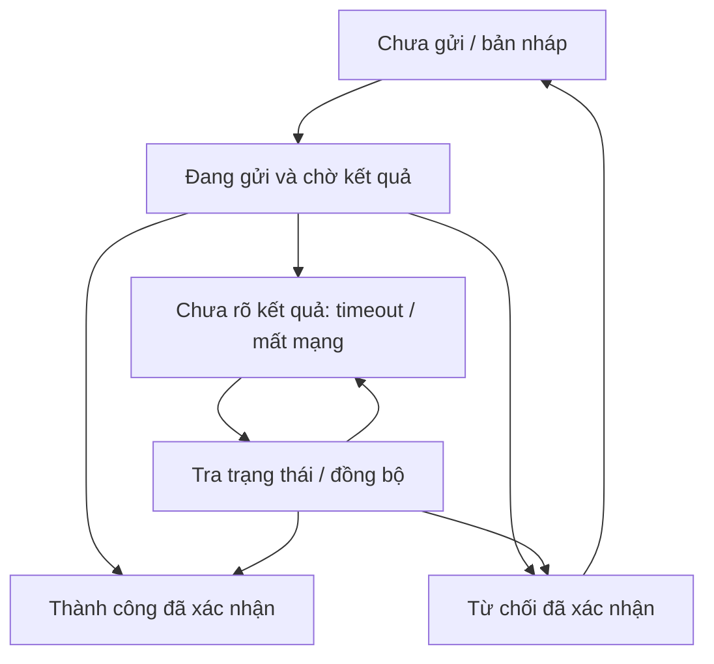

# UI-05 — Ma trận trạng thái tương tác và phản hồi

**Ngày:** 21/10/2026 · **Phiên bản:** 1.0  
**Trạng thái:** Hoàn thiện đặc tả trạng thái/ma trận/luồng mẫu; chưa dựng component hoặc kết nối API.  
**Phạm vi:** MMORPG 2.5D pixel V4; thủ thành giữ nguyên. Kế thừa token UI-01, luật thao tác UI-02 và bố cục UI-03/04.

## 1. Ba trục trạng thái độc lập

Tách trạng thái tương tác của control, trạng thái dữ liệu của panel và trạng thái yêu cầu nghiệp vụ. Một nút có focus không có nghĩa được phép mua; một bảng có dữ liệu không có nghĩa dữ liệu mới nhất; đóng cửa sổ không có nghĩa request đã hủy.

Ví dụ: inventory có dữ liệu cũ, item đang chọn, request mua chưa xác định kết quả. UI phải biểu hiện cả ba, không thay tất cả bằng một spinner toàn màn che cảnh báo gameplay.

## 2. Trạng thái control

| Trạng thái | Hình/phản hồi | Quy tắc |
|---|---|---|
| Mặc định | Theo token nền/viền, nhãn rõ. | Không animate liên tục để gọi chú ý. |
| Hover | Nền/viền nhấn nhẹ, tooltip phù hợp. | Không tự chọn/mua/equip. |
| Focus | Ring và dấu góc, hỗ trợ bàn phím. | Có thể cùng selected hoặc disabled để đọc lý do. |
| Pressed | Hạ một bậc, phản hồi ngắn. | Không đồng nghĩa server đã chấp nhận. |
| Selected | Tick/chân tab và nhãn được chọn. | Khác trang bị/kích hoạt thật nếu mới là bản nháp. |
| Locked | Khóa + điều kiện còn thiếu. | Không có quyền theo cấp/nghề/quest; không giải khóa bằng client. |
| Disabled | Nhãn đọc được, lý do theo ngữ cảnh. | Có quyền chung nhưng hiện không đủ tiền/combat/sai vũ khí/vùng. |
| Pending | Đang mua/Đang lưu..., dấu tiến trình có nghĩa. | Khóa gửi lặp cùng thao tác, không khóa mọi phần độc lập. |
| Success | Tick + kết quả ngắn, cập nhật giá trị thật. | Chỉ sau phản hồi có thẩm quyền. |
| Error | Dấu chéo + nguyên nhân + cách xử lý. | Không chỉ đổi nút đỏ hoặc phát âm thất bại. |

Các trục không thay thế nhau: selected + locked có thể là lựa chọn kế hoạch chưa học, cần nhãn Chỉ xem. Focus phải thấy ngay cả khi hover khác. Không dùng giảm opacity khiến tên/lý do khó đọc. Badge ưu tiên lỗi chặn thao tác; tooltip có thể liệt kê thêm các điều kiện thiếu, không chồng bốn icon lên một nút.

## 3. Trạng thái dữ liệu panel

| Trạng thái | Cách hiển thị | Hành động |
|---|---|---|
| Chưa tải | Khung/skeleton đúng bố cục, không số dư hoặc item giả. | Tải theo quyền khi mở. |
| Đang tải lần đầu | Nhãn Đang tải và tiến trình nếu biết tổng. | Đóng/Quay lại khi luồng cho phép. |
| Sẵn sàng | Dữ liệu hiện tại được phép xem. | Thao tác theo điều kiện nghiệp vụ. |
| Đang làm mới | Giữ dữ liệu cũ có dấu Đang cập nhật. | Không làm mất vị trí/selection; thao tác nhạy cảm có thể chờ xác nhận. |
| Rỗng thật | Mô tả chưa có vật phẩm/nhiệm vụ, có bước tiếp theo hợp lệ. | Không gợi nạp mặc định để lấp túi. |
| Không có kết quả lọc | Ghi không khớp bộ lọc. | Nút Xóa bộ lọc; không nói túi không có gì. |
| Thiếu quyền | Lý do và nguồn mở quyền nếu được biết. | Không tải/hiện dữ liệu riêng rồi che bằng overlay. |
| Dữ liệu cũ | Dấu Chưa đồng bộ và thời điểm nếu có nguồn tin cậy. | Làm mới; không hiển thị thành số dư tiêu được đã chắc chắn. |
| Lỗi tải | Phạm vi lỗi rõ, dữ liệu cũ nếu hợp lệ. | Thử tải lại; lỗi đọc không tự gửi lại mua. |
| Hết hạn | Nhãn hết hạn và trạng thái được xác nhận. | Làm mới báo giá/đề nghị; không tự chuyển sang món khác. |

Loading không dùng thanh 100% giả; khi chưa biết tổng dùng trạng thái không xác định. Skeleton chỉ là hình trống trung tính, không avatar/item dễ hiểu là đã sở hữu. Lỗi một tab không phá tab còn hoạt động. Reconnect cần đồng bộ trước bật lại thao tác tài sản.

## 4. Vòng đời yêu cầu nghiệp vụ

Không vẽ timeout thành thất bại chắc chắn. Timeout sau gửi có thể là server đã commit nhưng phản hồi chưa về. Lệnh cần request identity/idempotency và đường tra cứu do DATA/NET/ECON thiết kế; tài liệu UI chỉ yêu cầu hành vi, chưa tạo cơ chế backend.

Thông báo Chưa xác định kết quả. Đang kiểm tra, vui lòng không thực hiện lại thay cho Mua thất bại khi chưa có bằng chứng. Cho thử kết nối/tra trạng thái, không tự tạo request mua mới. Nếu retry cùng yêu cầu được backend hỗ trợ, phải giữ identity gốc; client không tự quyết reset identity vì đổi panel.

## 5. Hủy, đóng và thao tác đang xử lý

Trước gửi: Hủy loại bỏ đề nghị chưa commit theo luật bản nháp, không gọi là hoàn tiền. Sau gửi: Đóng chỉ ẩn panel; Hủy yêu cầu chỉ có nếu backend có cơ chế và kết quả rõ. Không phát Đã hủy khi mới bấm nút.

Kết quả đến sau đóng panel cập nhật state đúng một lần và báo gọn/log. Mở lại phải thấy kết quả authoritative, không spinner cũ hoặc bản dự kiến. Không tự mở modal lớn giữa combat để báo giao dịch đã xử lý; cảnh báo và hành động phục hồi theo UI-02.

Nhiều thao tác độc lập có thể pending riêng khi hệ nghiệp vụ cho phép; không tùy tiện cho song song thao tác trên cùng item/tiền/phiếu. Phạm vi khóa thao tác được backend xác nhận, không chỉ một nút local.

## 6. Ma trận ví dụ theo hệ thống

| Hệ | Trường hợp | Phản hồi yêu cầu |
|---|---|---|
| Skillbook | Phân điểm thử | Chưa áp dụng, điểm dự kiến khác điểm đang hiệu lực. |
| Skillbook | Combat bắt đầu trước commit | Từ chối theo state thật, giữ nháp; không trừ điểm. |
| Skillbook | Thiếu SP/TP | Nêu loại điểm và phần còn thiếu; không đề nghị tiền nạp thay thế. |
| Kỵ Sĩ | Đang đi bộ | Skill nghề khóa tạm Cần ngựa chiến, dẫn Gọi ngựa nếu hợp lệ. |
| Skill | Sai vũ khí/thiếu mana/CC | Lý do đúng; không dùng hết mana làm trạng thái Chưa học. |
| Shop | Không đủ tiền | Hiện đúng loại tiền/giá/số thiếu khi được biết; không âm thầm đổi loại ví. |
| Shop | Báo giá/hàng thay đổi | Hết hiệu lực đề nghị, tải lại và xác nhận mới; không tự mua giá mới. |
| Inventory | Túi đầy | Nêu vấn đề thao tác đích; quyền nhận thưởng tồn tại theo hệ loot, không tự phá đồ. |
| Equip | Chưa đủ nghề/cấp | Khóa có yêu cầu, không xóa món khỏi túi. |
| Item | Quest/event hết hạn | Trạng thái dựa dữ liệu hệ thống; chỉ thời gian client hết không đủ quyền xóa item. |
| Giao dịch | Đề nghị bên kia thay đổi | Bản xác nhận cũ mất hiệu lực, xem lại; không giữ tick đồng ý cũ. |
| Settings/layout | Local storage không lưu được | Cho dùng trong phiên, báo Chưa lưu được; không nói lỗi database nhân vật. |
| Collection | Chưa khám phá | Placeholder không spoiler, khác lỗi mạng. |

Các ví dụ không hoàn thiện toàn bộ SHOP/TRADE/LOOT; mỗi hệ phải có state matrix riêng khi thiết kế sâu. Nút retry cũng cần kiểm điều kiện hiện tại, không giữ quyền từ lúc panel mở.

## 7. Văn bản phản hồi

Thông báo gồm việc gì, nguyên nhân có thể công bố và bước tiếp theo. Ví dụ:

- Không thể đổi bộ kỹ năng khi đang giao chiến. Bản nháp được giữ lại.
- Cần cưỡi ngựa chiến để dùng kỹ năng này.
- Giá đã thay đổi. Hãy xem lại đề nghị trước khi mua.
- Chưa xác định kết quả giao dịch. Đang kiểm tra trạng thái.
- Không có vật phẩm phù hợp bộ lọc. Xóa bộ lọc để xem tất cả.

Không hiển thị stack trace, SQL, đường dẫn riêng hoặc thông tin tài khoản người khác. Mã hỗ trợ an toàn có thể kèm để tra cứu; văn bản chính không chỉ là Error 500. Không báo thiếu quyền theo cách làm lộ nội dung quest/boss chưa khám phá.

## 8. Hết hạn và đồng hồ

Thời gian event, báo giá, trade và buff lấy mốc authoritative; client đếm để trình bày rồi đồng bộ khi cần. Đồng hồ máy người chơi đổi không làm gia hạn item hoặc bỏ khóa. UI ghi múi giờ/ngữ cảnh khi là lịch sự kiện, tránh chỉ 20:00 không ngày.

Khi hết hạn dự kiến, khóa thao tác nhạy cảm chờ xác minh và làm mới; không tự tiêu/hủy món hoặc nhận quà. Không chuyển mọi thứ sang thất bại nếu chỉ màn hình background khiến đếm giật. Giá, stock, deadline và quyền là snapshot có version khi nghiệp vụ yêu cầu.

## 9. Chuyển động và khả năng đọc

Pressed/loading/success dùng chuyển động ngắn cùng chất pixel; không spinner lớn che actor hoặc flash toàn panel. Có tùy chọn giảm chuyển động, icon/text vẫn rõ. Pending cho focus vào Đóng/Trợ giúp/Tra trạng thái nếu hợp lệ; không bẫy bàn phím vào nút vô hiệu.

Thông tin theo vùng ưu tiên: lỗi ô nhập đặt gần ô; lỗi thao tác ở footer/panel; mất mạng toàn phiên ở lớp hệ thống. Tooltip giải thích không biến thành modal liên tục. Lỗi lặp gộp thông báo, có log; không phát hàng chục tiếng báo vì giữ phím.

## 10. Hợp đồng bàn giao và kiểm chứng sau

Mỗi component/màn phải có state map, dữ liệu kích hoạt, nhãn/icon, hành động cho phép, cách thoát và nguồn authoritative. Các tổ hợp focus+locked, refreshing+selected, unknown-result+closed phải được thể hiện, không chỉ mười ảnh rời không có chuyển trạng thái.

Cần kiểm gửi mua rồi mất mạng, phản hồi đến muộn, timeout trước/sau commit, bấm lặp, quote thay đổi, túi đầy, combat trong lúc áp build và chỉnh đồng hồ máy. Xác nhận không nhân tiền/item/điểm; dùng backend thật hoặc harness được ghi rõ, không lấy UI mock chứng minh server đúng.

UI-05 hoàn thiện hồ sơ; chưa có component, API hoặc kết quả kiểm. UI-10/11 và DATA/NET/ECON vẫn là task riêng. Tổng **23/513 hoàn thiện thiết kế, 6 một phần, 484 chưa thiết kế**. Tiếp theo UI-06: thứ tự chồng, đóng cửa sổ, nháp chưa lưu và chống click xuyên. Thủ thành giữ nguyên.
