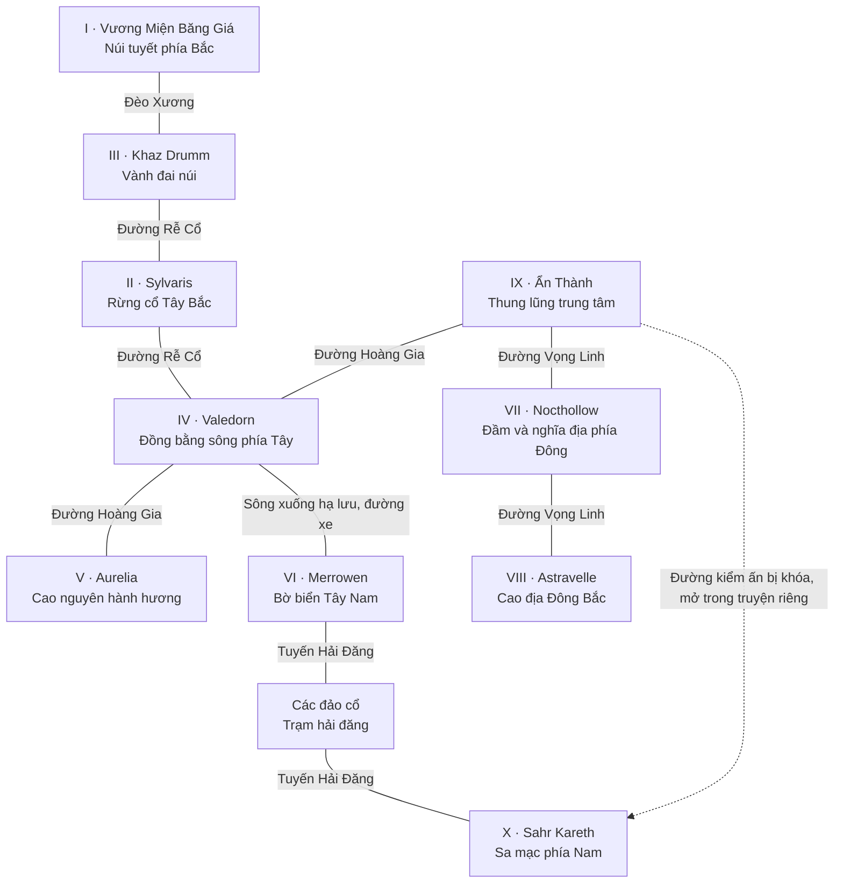
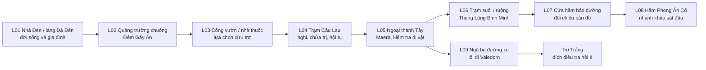

> **Phạm vi bản đồ bổ sung ·22/10/2026:** [187](../mmorpg-design-checklist-v1/187_MAP_DONG_BO_PHE_BANG_HOI_VA_W06.md) đặt W06 ở vành Đông Nam và trụ sở phe trên hai hành lang Tây/ĐôngIX. Không thay mười thành/tuyến lịch sử, không mở đường kiểmấnIX–Xsớm; năm vùng PvEcũ vẫn có lộ trình khôngPK. Vị trí chưa phải bản vẽ tỷ lệ.

> **Gameplay hiện hành ·22/10/2026:** nhân vật tối đa60, nội dung năm vùng tới45; các ghi chú cap45 bên dưới là lịch sử. [MAP-01 mô tả mới](../mmorpg-design-checklist-v1/185_MAP_01_DIA_LY_ELARION_VA_MANG_DUONG.md) phân biệt địa lý thế giới/sector sản xuất; chưa có bản đồ tỷ lệ. Giữ tên thành và tuyến nguồn.

# 03 — Địa lý cốt truyện và hành trình

**V1:** sơ đồ quan hệ, không phải bản đồ tỷ lệ, dữ liệu map hoặc yêu cầu tile/asset.

> **Cập nhật gameplay 20/10/2026:** bảng dải gốc bên dưới là lịch sử thiết lập, không phải cap bản phát hành. [PROD-06 V2](../mmorpg-design-checklist-v1/15_PROD_06_PHAM_VI_VA_NGAN_SACH.md) và [PROD-08](../mmorpg-design-checklist-v1/17_PROD_08_CAP_DO_VA_MO_RONG.md) chốt bản đầu năm vùng, cap 45. Những nhánh 50+ nếu có thuộc nội dung tương lai; không phát hành nội dung bắt buộc vượt cap. Mười thành và mạng địa lý giữ làm nền, không đồng nhất với năm map sản xuất.

## 1. Sơ đồ Elarion

Dãy núi phía Bắc chia lưu vực Sylvaris và Khaz Drumm; rừng mọc ở sườn ẩm Tây Bắc. Sông từ chân núi đi qua vùng Valedorn rồi ra Merrowen. Ẩn Thành nằm trong thung lũng trung tâm, có các suối nhánh nhưng không nằm ngay cửa biển. Nocthollow ở vùng nước đọng phía Đông; Astravelle nằm trên cao địa phía trên đầm. Sahr Kareth ở miền khô phía Nam, tiếp cận ban đầu bằng hải trình để tránh vành đai đất nứt.

## 2. Mã thành và cấp độ

Giữ nguyên dải thành từ tài liệu nguồn; dải tiến trình nhân vật là định hướng khác, không tự ép hai bảng thành một. Mức dưới đây chỉ là nhãn thiết kế nội dung, chưa phải thông số gameplay.

| Thành | Dải gốc | Sử dụng trong truyện chính | Trung tâm an toàn / phần nguy hiểm |
|---|---|---|---|
| IX Ẩn Thành | 1–15 | Hồi I; trở lại ở V | Ngoại thành có dân; nội thành lõi và một số nhánh hầm chưa vào được ở cấp 1–10 |
| IV Valedorn | 5–18 | Cuối I mở đường; đầu II làm đầu mối | Bến/chợ/nhà hội an toàn; đường hàng bị cướp và Hầm Rượu là nhánh khác |
| VI Merrowen | 10–25 | Có thể khám phá sớm; nhánh chứng cứ ở III | Cảng hoạt động; xác tàu/đảo nguy hiểm nằm ngoài cảng |
| II Sylvaris | 12–28 | Hồi III, có thể gặp biên dân trước | Làng khách không là toàn bộ rừng; Rễ Thế Giới là vùng sâu |
| V Aurelia | 18–32 | Hồi II sau chặng Valedorn | Tu Viện Tro Trắng trên đường hành hương tiếp cận trước, không yêu cầu đánh Hầm Mộ ở lần đến đầu |
| VII Nocthollow | 18–34 | Hồi IV, có thể đến trước | Khu cư dân Bất Tử Giả khác nghĩa địa bị xáo trộn |
| I Vương Miện Băng Giá | 20–35 | Hồi V tìm bộ dự phòng | Đồn trú có nơi nghỉ; Lò Rèn Cổ là hành trình riêng, không tự tăng toàn bộ quái lên cấp người chơi |
| VIII Astravelle | 25–40 | Hồi IV | Học viện/nhà trọ khác tháp bị khóa; nhiệm vụ chính có đường tiếp cận an toàn |
| III Khaz Drumm | 28–42 | Cuối III, quay lại V | Hội thợ ở cửa núi khác Mạch Đá Nguyên Thủy |
| X Sahr Kareth | 30–45 | Hồi VI và vùng tiếp xúc cuối | Ốc đảo có thể đến sớm; vùng tiếp xúc cuối thuộc dải 41–50+ của nguồn, không đẩy cả thành lên 50 |

Hồi I được thiết kế hoàn chỉnh ở cấp 1–10. Hồi II–VI dùng các mốc điều tra, không khóa chỉ vì số thứ tự thành. Không đặt một lần gặp NPC trong thành an toàn sau boss raid. Khi người chơi vượt cấp vùng cũ, quái vùng cũ không tự mạnh lên chỉ để trì hoãn truyện.

Dungeon được nêu trong nguồn (Lò Rèn Cổ, Rễ Thế Giới, Mạch Đá Nguyên Thủy, Hầm Rượu Hoàng Gia, Hầm Mộ Các Thánh, Xác Tàu Đắm Dưới Biển, Nghĩa Địa Vọng Linh, Đài Thiên Văn Bị Khóa, Hầm Phong Ấn Cổ, Lăng Mộ Vị Vua Không Tên) giữ danh tính. Truyện chính lấy manh mối ở nhánh khảo sát solo; phiên bản tổ đội nếu có kể lớp bổ sung. Không mặc định toàn bộ dungeon này đã được thiết kế chi tiết.

## 3. Vì sao còn người ở Ẩn Thành?

Thành có ba vành: lõi kiểm ấn, khu cư trú giữa và các lũy ngoài. Đêm Gãy Ấn phá phần lõi và một số phố gần nó, không xóa cả thung lũng. Cửa chắn cơ học và nền móng Thạch Tộc ngăn sụp đổ lan sang lũy phía Tây. Người sống sót tập trung quanh kho nước, trạm chữa trị và cổng có thể vận hành thủ công. Các giếng ngoài lõi vẫn dùng được nhưng phải kiểm tra nhiễm cộng hưởng.

Cộng đồng tồn tại nhờ ruộng còn lại ở Thung Lũng Bình Minh, đoàn xe Valedorn và công sức dân quân. Có thiếu thốn, tranh luận phân phối và gia đình ly tán; không mô tả thành bị bỏ hoang hoàn toàn rồi đột ngột có chợ đông chỉ để thuận gameplay.

## 4. Tuyến đường và cách mở

| Tuyến / trở ngại | Lý do trong thế giới | Cách vượt và ảnh hưởng tự do |
|---|---|---|
| Đá Đèn → trạm Cầu Lau | Lũy bị tấn công, cầu chính hỏng | Cứu trợ mở đường dốc; không thắng một minigame thì dân khác vẫn giúp dựng ván |
| Trạm Cầu Lau → ngoại thành | Phải kiểm tra dấu nhiễm trên vật dụng và người bị thương | M04 có người bảo lãnh; không xét chủng tộc là dấu nhiễm |
| Ngoại thành → Valedorn | Đường xe có đoạn gãy | Ngay sau M04 có lối đi bộ/đoàn dân; M08 cấp giấy giới thiệu tiện hơn, không khóa khám phá chờ hết chương |
| Valedorn → Merrowen | Hàng rào thuế và thiếu chỗ thuyền | Đi đường hạ lưu, trả phí vận chuyển theo thiết kế kinh tế sau, hoặc giúp đoàn cứu trợ; nhiệm vụ chính có chuyến được bảo đảm |
| Đường Rễ Cổ | Liên Minh kiểm soát vì khai quật trái phép | Nói chuyện, đi theo người dẫn, hoặc đường mòn rủi ro; không bắt giết thủ hộ để có quyền đi |
| Đèo Xương | Băng sụt, cáp kéo cần sửa | Thuê người dẫn ở đồn; nhiệm vụ V có tuyến bảo hộ solo |
| Nocthollow → Astravelle | Sương lệch hướng ở vùng trũng | Mốc đèn/đường cao; chỉ tắt shortcut, không xóa mọi lối |
| Tuyến Hải Đăng → Sahr Kareth | Hải đăng sai nhịp làm tàu mất hướng | Đối chiếu bản đồ trong III/V, kích hoạt một trạm; không bắt phụ thuộc guild có tàu |
| Điểm dịch chuyển cổ | Cần xác nhận hai đầu và một nguồn ổn định | Mở sau tiếp cận địa lý; không thay việc lần đầu khám phá bằng bấm thẳng vào nút chưa biết |
| Lối trung tâm IX → X | Đứt chứng thực và nguy cơ làm sập điểm neo | VI mở trong phần truyện riêng sau giải thích rủi ro; tuyến biển vẫn tồn tại |

## 5. Sơ đồ vùng cấp 1–10

Vùng đầu có nơi yên tĩnh, bếp tập thể, công việc thường ngày và những đoạn đường có thể trở lại. “Đêm đầu” là chương trải nghiệm riêng. Làng chung sau thảm họa cho thấy một cộng đồng đang sửa chữa; người đến muộn không gặp đồng đội đang sống trước đêm trong cùng một quán.

L03 có hai lối cứu trợ đủ gần để thấy hậu quả ưu tiên nhưng không tạo lựa chọn giả “cứu hết bằng chạy nhanh”. L04 là điểm nghỉ sớm để người chơi dừng phiên. L05 giới thiệu việc cần làm chứ không bắt nhận cả sáu nhiệm vụ phụ. L06 có không gian quan sát không đánh nhau. L08 là nhánh có lối thoát quay lại L07; đi sâu vào nội thành IX vẫn bị chặn bởi hạ tầng hỏng, không phải yêu cầu hết sạch nhiệm vụ phụ.

## 6. Bản sắc cảm giác phục vụ người viết

Đá Đèn: tiếng bát, đèn vàng, đồ dùng nhiều kích thước cho gia đình đa chủng tộc. Ngoại thành: tiếng búa sửa cửa xen lời gọi tìm người. Bình Minh: nước chảy bị ngắt nhịp và đàn thú tìm bờ sạch. Hầm: khóa quay, lời chỉ dẫn lặp thiếu nửa câu, rễ cây mọc qua biển cấm. Các chi tiết này là chỉ dẫn kể chuyện môi trường, chưa là yêu cầu tạo âm thanh hoặc asset.
