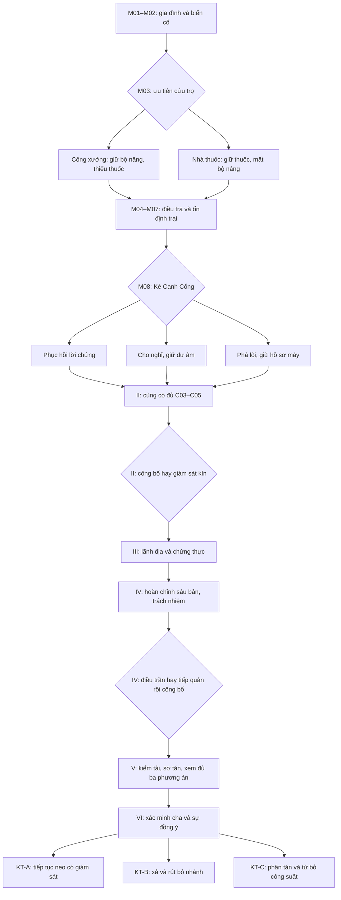

> **Canon hiện hành · 22/10/2026:** [Rà soát thống nhất nhân vật và mạch truyện](12_RA_SOAT_CANON_NHAN_VAT_VA_MACH_TRUYEN.md) làm rõ ba chủng tộc, nghề 15/nhánh 30, HGD đi bộ, vũ khí và phạm vi bí mật. Nguồn 00 giữ lịch sử, không dùng quy tắc tạo nhân vật cũ.

> **Ưu tiên biên tập hiện hành ·22/10/2026:** [Bản kể năm vùng0.1](11_TUYEN_TRUYEN_XUYEN_SUOT_NAM_VUNG_BAN_DAU.md) nối các khung truyện cũ thành hành trình; [kế hoạch205](../mmorpg-design-checklist-v1/205_UU_TIEN_COT_TRUYEN_XUYEN_SUOT_LORE_VUNG_VA_NPC.md) ưu tiên lore vùng/NPC/quest trước hệ phụ. Chưa viết xong toàn bộ82NPC hoặc lời thoại sản xuất; giữ lịch sử thật và sáu hồi.

> **Biên tậpV2 · 21/10/2026:** [Ràng buộc combat/canon10](10_RANG_BUOC_COMBAT_V2_VA_BI_MAT.md) và [khếước128](../mmorpg-design-checklist-v1/128_V2_KHE_UOC_COT_TRUYEN_VA_COMBAT.md) bổ sung hồi sinh nguykịch, Orenvỏ/lõi, quyềnchọnvàscope5vùng/6hồi. Không thaynguồn00 hoặc đápánlịchsử02; chưa triển khai.

# 04 — Sáu hồi, lựa chọn và kết thúc

**SPOILER — bản đề cương toàn truyện V1.** Tất cả nút chính dưới đây có đường solo. Các nhiệm vụ đầu dùng mã M; các nút sau dùng II-1…VI-4 để người viết truy nguyên, chưa phải nhiệm vụ đã triển khai.

## 1. Tóm tắt từ đầu đến cuối

Người chơi trở về Nhà Đèn, nơi người cha nuôi Edran đã để lại một dụng cụ trước chuyến đi điều tra. Đêm Gãy Ấn buộc họ chọn ưu tiên cứu trợ và rút về ngoại thành. Dấu vết trong hầm bảo dưỡng cho thấy hệ thống canh thành bị đổi lệnh; cha từng tìm đến Tu Viện Tro Trắng. Điều bắt đầu như một cuộc tìm người trở thành câu hỏi về quyền sử dụng sức mạnh của các cộng đồng khác.

Tại Tro Trắng, người chơi phát hiện những bản giao ước đã bị xóa quyền từ chối. Một thành phố mất tích từng bị dùng làm bằng chứng rằng có thể giữ linh hồn trong kết giới. Đi qua lãnh địa thủ hộ, họ nghe những lời kể không thể gói gọn thành “quái vật phản bội”. Các thành đã giữ những dấu chứng thực cũ và tiếp tục dùng chúng như thể người ký không được phép đổi ý.

Hồ sơ Astravelle chứng minh cảnh báo năm 903 bị sửa; chương trình Gia Hạn bỏ qua quyền đồng thuận là nguyên nhân nền của thảm họa, còn nghi thức mở nhánh của Kael làm nó trầm trọng hơn. Edran bị giữ rồi tự nguyện làm neo khẩn cấp để hạn chế sụp đổ. Người chơi công bố bằng chứng theo cách mình chọn và xây một liên minh đủ để tiếp cận buồng cuối.

Sau khi đo thử các phương án và hiểu giá phải trả, họ tìm thấy cha còn sống. Ông không xin một đứa con thay chỗ mình. Cả gia đình và các bên ký giao ước được quyền nói rõ điều mình chấp nhận. Người chơi quyết định duy trì điểm neo có kiểm soát, giải phóng cha và rút bỏ phần mạng, hoặc tái lập liên kết phân tán dựa trên các cam kết có thể gia hạn. Không lựa chọn nào phục hồi nguyên trạng mọi người, mọi ký ức và mọi thành.

## 2. Khung cảnh/nút từng hồi

### Hồi I — Tro Tàn Quê Nhà

- **Mục tiêu:** bảo vệ những người mình biết, ổn định nơi trú và xác minh lộ trình của Edran.
- **Xung đột:** nhu cầu cứu trợ trước mắt cạnh tranh với mong muốn đi tìm cha; có người nghi gia đình liên quan di vật hỏng.
- **Tuyến:** M01 Nhà Đèn → M02 Mười tiếng chuông → M03 Hai lối qua lửa → M04 Người không bỏ thành → M05 Dấu ấn không chọn người → M06 Nước chảy ngược → M07 Dưới lớp cửa cũ → M08 Một lối về Tro Trắng.
- **Khám phá:** C01–C06; biết dụng cụ không cần huyết thống, cơ chế bị sửa từ trong và cha có dấu chân điều tra.
- **Lựa chọn:** ưu tiên công xưởng hoặc kho thuốc ở M03; phục hồi, cho nghỉ hoặc phá lõi Kẻ Canh Cổng ở M08.
- **Hệ quả:** phương thức sửa trại và lời cảm ơn khác nhau; người canh cổng có thể trở thành nhân chứng, ký ức được lưu hoặc hồ sơ máy thay lời chứng. Không mất đường chính.
- **Cảnh chốt:** Maera đặt cạnh nhau phiếu Tro Trắng và bản khắc vừa lấy. “Giờ ta có một câu hỏi có địa chỉ. Phần còn lại là cậu có muốn đi hay không.”
- **Cầu nối:** nhận giấy giới thiệu tới Valedorn và hướng Tro Trắng. Được ở lại khám phá, không có đồng hồ ép rời vùng.

### Hồi II — Những Cái Tên Bị Xóa

- **Mục tiêu:** xác thực chuyến đi của cha tại kho Tro Trắng.
- **II-1 — Hợp đồng không tới bến:** Tovan ở Valedorn giúp đối chiếu hàng mất tích 941 với phiếu niêm phong. Điều tra bến và nói chuyện người sống, không kết luận do “quái mạnh” bằng cách giết đủ số lượng. Mở tuyến Merrowen để tự khám phá.
- **II-2 — Trang còn vết dao:** Tessa chỉ ra những chữ bị cạo trong bản giao ước tại Tu Viện; người chơi dùng bản in cũ trong kho cứu hỏa để đọc lại quyền rút. Không cần ăn trộm hoặc chọn class có tàng hình: yêu cầu công khai, giúp di chuyển kho, hoặc nhờ một người có thẩm quyền chứng kiến đều tới cùng tài liệu.
- **II-3 — Danh sách không có mộ:** lần theo các tên Veyr bị chuyển sang sổ vật tư. Một biên bản dân sự độc lập cho thấy họ là cư dân, chưa xác nhận tất cả đang sống.
- **II-4 — Một lời chứng hay nhiều người bị lộ:** Orien đề nghị sửa hồ sơ âm thầm để tránh bạo loạn. Người chơi chọn công bố bản sao đã che danh tính nhân chứng hoặc bàn giao cho nhóm giám sát có Tessa và đại diện dân. Cả hai vẫn có bản chứng do mình giữ; không phải lựa chọn giao bằng chứng rồi bị khóa truyện.
- **Khám phá:** C07–C08; “phong ấn thứ bảy” là quy trình đồng thuận, không phải vị thần thứ bảy đang ngủ.
- **Hệ quả:** công bố khiến người dân sớm yêu cầu đối chất, Tessa bị giám sát; giám sát kín bảo vệ người lưu trữ nhưng việc tiếp tế tới người tìm thân nhân chậm hơn. Các cảnh riêng và thư ghi rõ, không tắt dịch vụ Aurelia.
- **Cầu nối:** bản văn nêu sáu phương thức chứng thực. Cần nghe người giữ chúng, không chỉ đọc bản chép của loài người.

### Hồi III — Lời Thề Của Sáu Dòng Thủ Hộ

- **Mục tiêu:** xác nhận các điều khoản giao ước và nguyên nhân thù địch.
- **III-1 — Đất có người ở:** tại Sylvaris, người chơi đưa đoàn cứu trợ khỏi nơi đánh nhau; Lethra giúp gặp Varra Nhal. Cứu trợ có đường thương lượng và bảo vệ đoàn, không bắt dâng một đầu thủ hộ.
- **III-2 — Dấu chân dời ranh:** Lang Tộc chứng minh mạch mới đã đẩy thú khỏi nguồn nước. Chọn kế hoạch đường vòng cho xe hoặc trạm trung chuyển giới hạn; cả hai phải có đường sống cho cư dân và thú. Chứng thực Lang được trao vì giải quyết tranh chấp có nhân chứng.
- **III-3 — Lá thư đi bằng biển:** Merrowen, Aeris Tal và người lái đò Yara xác nhận một chuyến hàng bị đổi nhịp đèn. Lấy bản đồ từ nhánh khảo sát solo của xác tàu; phần khám phá nhóm chỉ thêm chuyện thủy thủ.
- **III-4 — Nền móng cũng biết đau:** Dorn Bar ở Khaz Drumm đối chiếu mức tải của các trụ. Bảo vệ thợ dừng một máy hỏng hoặc chuyển tải sang tuyến dự phòng, rồi trả quyền kiểm tra cho hội thợ. Không phá một thành núi để chứng minh mình phản đối khai thác.
- **III-5 — Nước, ký ức và nhân chứng:** Sira Nym trình điều khoản Xà; Thariel cho kiểm tra phiến ký ức Long ở trạm trung lập. Hai bản không hoàn toàn giống lời Giáo Hội nhưng khớp cấu trúc. Điều khoản Bất Tử cần gặp Ena Seth tại Nocthollow ở đầu IV.
- **Khám phá:** C09 được thu theo từng phần, không phải sáu mảnh xác boss. Tới cuối hồi đã rõ lời thề có nghĩa vụ song phương; bộ sáu chỉ hoàn chỉnh khi có Ena.
- **Lựa chọn:** mô hình tiếp tế tôn trọng lãnh địa; đặt đại diện dân tị nạn hay đại diện phường nghề làm người liên lạc. Không khóa phe vĩnh viễn.
- **Hệ quả:** đoàn người, thư và nhân sự có mặt tại cuộc họp V khác nhau. Bất đồng vẫn còn, không biến mọi thủ hộ thành bạn thân sau một việc tốt.
- **Cầu nối:** các mốc tải cùng chỉ về Astravelle và Nocthollow; cần phân biệt số đo thật với danh tính bị gán cho nó.

### Hồi IV — Tội Lỗi Của Hội Đồng

- **Mục tiêu:** chứng minh ai đã làm gì và xác minh tình trạng Edran.
- **IV-1 — Con số bị bỏ đi:** gặp Rovan Tey, người học giả lôi thuật năm 903. So bản gốc, bản gửi và dấu sửa của người quản lý; Ena hoàn chỉnh C09 và giúp phân biệt lời người còn ý thức với dư âm.
- **IV-2 — Vọng linh có tên:** Nocthollow. Ena và Lys hướng dẫn nhận diện một nhân chứng thoát Veyr. Câu hỏi chéo và đồ dùng có niên đại xác thực lời khai; không dùng một giấc mơ để kết tội ai.
- **IV-3 — Gia Hạn:** ở nhánh khảo sát Đài Thiên Văn Bị Khóa, đối chiếu nhật lệnh Soren, sơ đồ máy và thử trên lõi vô tri. Người chơi thấy việc tước quyền từ chối dẫn đến phản hồi. Hồ sơ cho biết cha bị giữ và tự tạo neo; chưa đủ bằng chứng cha hiện còn sống.
- **IV-4 — Hai bàn tay trên một khóa:** tách nghi thức mở của Kael khỏi lịch chạy Gia Hạn. Đối chất Soren và Kael riêng; có cơ hội buộc họ cung cấp thông tin, không cần tin lời xin lỗi. Nếu một người bỏ chạy hoặc không hợp tác, máy và bản lưu đã đủ phần bắt buộc.
- **Khám phá:** C10–C12. Trách nhiệm được ghi theo hành động: ra lệnh, sửa hồ sơ, thực hiện hay chống lệnh, không kết tội toàn chủng tộc/phe.
- **Lựa chọn:** đưa bằng chứng ra phiên điều trần dân sự có đại diện các phe, hoặc buộc một ban giám sát liên phe tiếp quản nghiên cứu trước rồi công khai bản tóm tắt. Không có nhánh giấu vĩnh viễn mọi bằng chứng.
- **Hệ quả:** công khai trước cho người bị hại tiếng nói nhưng làm việc tiếp cận kho chậm; tiếp quản trước giữ được thiết bị nhưng nhân chứng chỉ đồng ý tham gia khi được bảo vệ. Cách bảo vệ là nhiệm vụ solo, không giá tiền bí mật.
- **Cầu nối:** muốn tháo cha khỏi neo cần giới hạn tải thực, bộ dự phòng phương Bắc và chấp thuận hiện tại của các bên.

### Hồi V — Mười Thành Trì Chia Rẽ

- **Mục tiêu:** biến hiểu biết thành phương án có thể thực hiện và làm rõ người trả giá.
- **V-1 — Bàn có đủ ghế:** cuộc họp tại phần ngoại thành Ẩn Thành còn sống. Người chơi mang đủ bản chứng; mọi dòng có đại diện, không yêu cầu danh vọng cao. Những việc phụ quyết định người quen nào tự nguyện hỗ trợ, không quyết định có được nghe phương án hay không.
- **V-2 — Lò rèn không phải kho chiến lợi phẩm:** đi Vương Miện Băng Giá. Tìm bộ kiểm tải trong nhánh khảo sát Lò Rèn Cổ, nghe hồ sơ 612 từ người giữ kho Thạch Tộc. Cơ chế solo dùng xe nâng và cửa chắn, không yêu cầu raid hạ Hộ Vệ Thạch Tâm.
- **V-3 — Ba bản đồ rút lui:** thiết kế sơ tán cho các khu không thể bảo vệ đồng thời. Chọn dùng đoàn xe để cứu người trước hay vật tư ổn định trước. Cả hai có phương án dân sự tối thiểu do nhiệm vụ chính cung cấp; không trừng phạt người bỏ qua phụ bằng cái chết hàng loạt.
- **V-4 — Thử trên thứ không biết đau:** thợ và Rovan thử cả ba cấu hình trên lõi vô tri. Cho thấy: duy trì neo ổn định nhất ngắn hạn nhưng tiếp tục bào mòn Edran; xả neo cắt một số lá chắn; phân tán buộc tháo các công trình tiêu thụ và có thể xóa ký ức gắn trong lõi.
- **V-5 — Quyền được đổi ý:** sáu đại diện xác nhận quyền tiếp tục hoặc từ chối. Người chơi giúp viết ba đề nghị có điều kiện và đưa bản ghi cho cha qua đường chuyển tiếp cuối. Không giả chữ ký nếu ai bị mất; nhánh chính luôn có người đại diện hợp lệ do chính cộng đồng cử.
- **Khám phá:** C13 và C16. Tất cả lựa chọn cuối được xem trước với bảng hậu quả; không có phương án thứ tư bất ngờ cần mua vật phẩm hoặc làm mọi nhiệm vụ phụ.
- **Cầu nối:** chuyến tới Sahr Kareth có chỗ cho người chơi solo; đồng minh hỗ trợ ngoài cảnh chiến đấu nếu không có tổ đội.

### Hồi VI — Người Cha Và Chiếc Khóa Sống

- **VI-1 — Điều khoản trên đá đỏ:** Sahr Kareth, bản gốc trong Lăng Mộ Vị Vua Không Tên được đối chiếu với sáu chứng thực. Nút khảo sát solo mở lối, không buộc giết Long Thủ Sa Mạc. Biết mạng vừa ngăn xâm nhập vừa giữ/xả những gì nằm bên trong.
- **VI-2 — Người cha không còn là lời đồn:** kiểm tra thân thể và quyền nhận dạng của Edran; có cuộc nói chuyện riêng về gia đình. Không dùng câu hỏi cha mẹ ruột để kiểm chứng, vì người chơi tự tạo xuất thân. Edran nhận ra kỷ vật Nhà Đèn và người chăm sóc xác nhận dấu nghề.
- **VI-3 — Không ai ký thay người khác:** gặp tiếng đáp Vael’Thor trong một kênh hạn chế. Hỏi về chức năng đường chuyển tiếp, đối chiếu C14/C16. Thực thể không cho toàn tri, không ra phán quyết đạo đức. Edran được nghe đủ ba phương án, tự đưa điều kiện của mình; người chơi có thể rời bàn để đọc lại, không bị ép bởi đồng hồ giả.
- **VI-4 — Chữ ký cuối:** thực hiện một trong ba cấu hình ở mục 4 bằng cơ chế solo; lựa chọn cá nhân không bị trưởng nhóm bỏ phiếu thay. Sau đó gặp lại gia đình, nhận phản hồi của người từng giúp và thấy giá của quyết định.

## 3. Sơ đồ nhánh và điểm hội tụ

Nhánh tùy chọn SQ/OR/ENV đi vào thư từ, người hỗ trợ và ký ức được kể lại; không thay bằng chứng bắt buộc ở đường giữa.

## 4. Ba kết thúc có điều kiện và cái giá

### KT-A — Ngọn đèn còn cháy

**Điều kiện:** hoàn thành VI-3; Edran đồng ý duy trì neo trong một kỳ kiểm tra có ngày kết thúc; đại diện ký quyền kiểm tra và quyền rút. Người chơi chọn “Duy trì, với điều kiện này”. Không có nhánh ép cha vô thời hạn rồi được gọi là kết thúc tốt.

**Thực hiện solo:** đưa đường dự phòng vào, chặn phản hồi để thợ từ xa thay lớp khóa hỏng; không đưa ai mới vào làm vật thế mạng. Soren không được độc quyền giám sát, dù nhánh trước có nhận ông làm người cung cấp chuyên môn.

**Kết quả:** giữ được phần lớn hạ tầng và sơ tán ít nhất trong ngắn hạn. Edran còn sống trong buồng neo, có các cuộc gặp cá nhân nhưng không về nhà. Ký ức ông tiếp tục suy giảm; những dấu vết khác bị giam trong cơ chế cũ chưa được trả tự do. Gia đình có thời gian tìm hướng khác nhưng không được hứa chắc sẽ cứu hết.

**Phản hồi:** Sella hỏi ngày kiểm tra tiếp theo, không chỉ ca ngợi sự hy sinh. Ena yêu cầu người bị giam có tên và đại diện. Thư cho thấy vùng được bảo vệ và những người không đồng ý với sự trì hoãn.

### KT-B — Mở cửa cho người trở về

**Điều kiện:** VI-3; Edran đồng ý rời neo; hoàn tất phương án sơ tán tối thiểu của V-3. Điều kiện sơ tán là bước truyện chính, không kiểm tra việc đã làm nhiệm vụ phụ.

**Thực hiện solo:** ngắt tuần tự theo bản đồ xả đã thử, giữ một hành lang thoát cho thân thể Edran. Không mở đồng loạt mọi khe nứt theo đề nghị cũ của Kael.

**Kết quả:** cha trở về, suy yếu và cần hồi phục; một phần dấu vết bị giam được chuyển tiếp. Một số nhánh lá chắn và điểm dịch chuyển ngừng hoạt động. Các khu dân cư bị ảnh hưởng đã được thông báo sơ tán, mất nhà và tài sản, phải xây lại tuyến tiếp tế. Không trình bày như cứu cha thì tất cả người khác chết, cũng không phủ nhận mất mát của họ.

**Phản hồi:** Mira vui vì ông trở về; Yara đưa thư của những gia đình phải chuyển chỗ ở. Edran tham gia công việc phục hồi nhỏ thay vì lập tức trở thành chiến binh khỏe mạnh.

### KT-C — Lời thề có người đáp lại

**Điều kiện:** VI-3; xem kết quả thử V-4; sáu đại diện có chữ ký hiện tại và xác nhận nghĩa vụ mới ở V-5. Tất cả đều có trên đường chính, không yêu cầu mức danh vọng ẩn hoặc thu thập đủ phụ. Người chơi có thể ký bổ sung điều khoản chăm sóc và phân phối nguồn đã thương lượng.

**Thực hiện solo:** chuyển nhận dạng sang nhiều trạm nhỏ có quyền gia hạn, giảm công suất trước khi tháo phần lõi gắn ký ức. Có cơ chế quan sát/xoay nhịp, không dùng sáu NPC làm sáu “pin sống”. Đồng minh hỗ trợ lời hướng dẫn ở xa; không yêu cầu sáu người chơi cùng đứng nút.

**Kết quả:** bỏ neo sống tập trung và tạo cơ chế vận hành cần lao động, nguồn vật lý cùng sự đồng ý định kỳ. Năng lượng bảo vệ ít hơn: phải đóng một số công trình dịch chuyển và rút khỏi vùng lõi khó duy trì. Gia đình không nhận lại Edran nguyên vẹn: phần ký ức gắn khóa bị mất, trong đó có nhiều năm ở Nhà Đèn; ghi chép giúp ông xây quan hệ lại, không phép nào chắc chắn trả trọn ký ức. Cái giá này được giải thích và Edran đồng ý trước lựa chọn, không tung ra sau chiến thắng để gây sốc.

**Phản hồi:** các cộng đồng tranh luận về ca trực và quyền rút; đây là công việc lâu dài chứ không phải hòa bình tuyệt đối. Edran hỏi tên người chơi một lần nữa trong căn bếp, rồi mời họ ngồi. Mira đưa cuốn sổ gia đình để cả nhà cùng bắt đầu lại.

## 5. Sau kết thúc trong một thế giới chung

Ba kết thúc là kết quả truyện cá nhân. Dùng không gian riêng cho buồng cuối, Nhà Đèn tái thiết và các cảnh về cha. Trong thế giới chung, các thành vẫn ở giai đoạn khẩn cấp hậu Đêm Gãy Ấn; các khu dân cư xa và việc rút công trình được kể bằng thư, nhật ký, đoàn người/cảnh riêng chứ không tắt một cổng dịch chuyển chung vì người chơi vừa chọn B/C.

Nhân vật khi quay lại giúp bạn cũ đang ở giai đoạn trước được ghi là “đồng hành hồi tưởng” của chương đó; không có NPC chung kể đồng thời cha đã về và cha đang bị giữ. Trong tương lai, sự kiện cập nhật toàn server phải có một mốc biên niên riêng được duyệt, không lấy kết thúc của người đầu tiên làm lịch sử cho mọi người.

Hồi kết giải đáp cha và Đêm Gãy Ấn. Nội dung sau vẫn có việc cứu dân, làm đường, điều tra Veyr và quan hệ phe; không bắt người chơi đảo ngược lựa chọn chỉ để tiếp tục kiếm trang bị.
