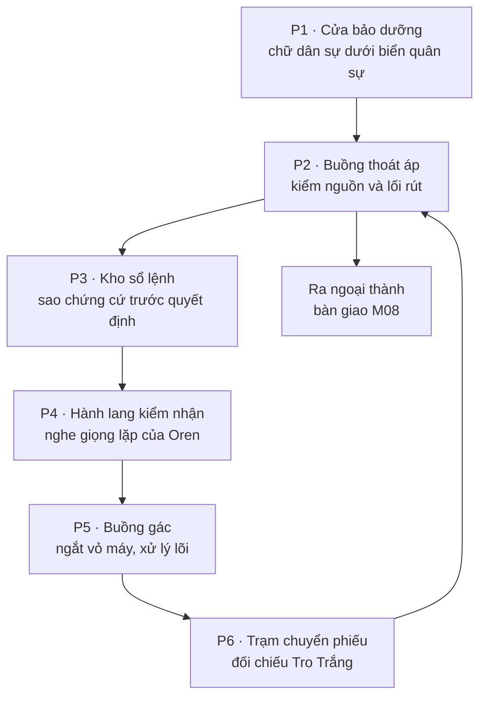

> **Biên tậpV2 · 21/10/2026:** [Ràng buộc combat/canon10](10_RANG_BUOC_COMBAT_V2_VA_BI_MAT.md) và [khếước128](../mmorpg-design-checklist-v1/128_V2_KHE_UOC_COT_TRUYEN_VA_COMBAT.md) bổ sung hồi sinh nguykịch, Orenvỏ/lõi, quyềnchọnvàscope5vùng/6hồi. Không thaynguồn00 hoặc đápánlịchsử02; chưa triển khai.

# 08 — Dungeon đầu: Hầm Phong Ấn Cổ

## 1. Mục đích và phạm vi

**V1:** nhánh khảo sát đầu của dungeon gốc tại thành IX, gắn M07/M08 và dải chương cấp 1–10. Các tầng nội thành sâu hơn vẫn chưa tiếp cận; không yêu cầu một nhân vật mới giải được toàn bộ mạng phong ấn dưới thành trung tâm.

Mục tiêu truyện: biến “quái canh cửa” thành một người từng có công việc, cho thấy lệnh bị sửa và để người chơi chọn cách xử lý khi đã có đủ thông tin. Kết thúc phải xác thực hướng Tro Trắng, không tiết lộ neo sống hoặc thủ phạm toàn truyện.

Trải nghiệm chính hoàn thành solo với né/đỡ/di chuyển cơ bản và dụng cụ tại chỗ. Không cần class cụ thể, kỹ năng bay, triệu hồi, hồi máu, đồ raid, ngọc thủ thành hoặc vật phẩm trả phí. Neris hướng dẫn qua đèn tín hiệu, không là AI phải bảo vệ khỏi chết để giữ đường truyện.

## 2. Sơ đồ phòng và câu chuyện qua không gian

### P1 — Cửa từng dành cho người thợ

Vách đá cao quá đầu người; tay nắm ở nhiều tầm, chứng tỏ công trình từng có thợ khác chủng tộc. Dưới biển cấm mới còn hai chữ “bảo dưỡng”. Dấu giày mang bùn từ ngoài vào khác vết cháy hướng từ trong ra. Có dây kéo cửa cơ học còn dùng được.

Người chơi mở bằng hướng dẫn nghề M05, không nhờ Dấu Kiểm Ấn phát nổ phá đá. Đây là thao tác được học, không cánh cửa chỉ “con của Edran” mở được.

### P2 — Nguồn luôn có nơi đến

Ống nước vòng qua một đèn còn sáng. Người chơi quan sát van có bảng hướng dẫn và mở nhánh xả nhỏ để ngắt nước qua bánh máy hỏng; nếu quay nhầm, đèn chỉ tắt, Neris giải thích và có thể trả van về. Không dìm chết dân ở một khu vô hình chỉ vì thử sai.

Mở một cửa rút về P1 ngay sau thao tác thành công. Dấu vết dụng cụ cho thấy người thợ trước đã cố giữ đường này hoạt động. Không bắt giải đố bằng màu đơn thuần: ký hiệu hình, vị trí và chữ cùng cho thông tin.

### P3 — Bằng chứng trước lưỡi kiếm

Một bàn biên nhận không bị cháy vì đặt trong hộp cơ học. Bản lệnh mới đóng lên bản cũ; đường nét khác niên đại. Sao bản lệnh, nhận tên Oren Keld và mã phiếu gửi Tro Trắng. C05 chính thức vào nhật ký tại đây; mọi nhánh boss sau đều giữ được.

Không cho thư ở đây ghi “Edran là neo sống” hoặc lộ tên Soren. Chỉ có chữ người gác từng phản đối đổi quyền kiểm nhận, cùng dấu dẫn đến cơ quan lưu bản trước khi đổi.

### P4 — Một câu không còn trọn

Tường còn hướng dẫn đưa người bị thương ra trước. Một âm thanh lặp “đoàn bảo…” rồi bị tiếng khóa cắt. Người chơi được đứng ngoài tầm gác để nghe hoặc lùi về; không bị khóa vào trận ngay khi nhặt hồ sơ.

Ba thiết bị xử lý được giới thiệu qua bảng bảo dưỡng có thể đọc cùng Neris: mạch đối chiếu, bộ tháo gắn kết và chốt phá nguồn. Chúng đều có năng lượng dự trữ tại hầm. Người chơi không phải có kỹ năng chữa linh hồn mới thấy phương án nhân đạo.

### P5 — Buồng gác

Đường đi đủ rộng cho né/đỡ cơ bản, có cột báo nhịp và một chỗ an toàn để rút khi quá tải. Các mảnh áo người gác gắn dưới khung, không dùng một xác quái vô danh rồi đột ngột nhận là cha. Bộ điều khiển nhận dạng cách vỏ chiến đấu một lớp khóa rõ ràng, giúp người chơi hiểu đánh bại vỏ chưa phải quyết định số phận người bên trong.

### P6 — Bản phiếu ở bên kia cửa

Phiếu hành trình lưu bằng cơ học, không phụ thuộc phần ký ức còn sống của Oren. Người chơi đối chiếu dấu với phiếu Maera: Edran đã yêu cầu xem bản lệnh nguyên thủy tại Tro Trắng. Lời chứng của Oren bổ sung tình cảm và ngữ cảnh nếu còn, không là cổng duy nhất để truyện tiếp tục.

## 3. Oren Keld — hồ sơ boss và trạng thái

**Tên gameplay truyện:** Kẻ Canh Cổng Tha Hóa. **Danh tính:** Oren Keld, người bảo vệ nhánh bảo dưỡng, thân thể đã chết; phần nhận diện còn trong khung gác. Không đồng nghĩa tất cả Bất Tử Giả đều sống theo cách này.

**Nhiệm vụ trước thảm họa:** bảo vệ thợ sửa và bảo đảm họ được rút ra. **Điểm gãy:** lệnh nhận dạng dân sự bị thay bởi lệnh đóng cổng quân sự; phản hồi 948 làm hai lệnh chồng nhau. Ông nhận ra dụng cụ của đồng nghiệp nhưng máy lại xác định người mang là xâm nhập.

**Hành vi kể chuyện:** dừng nửa nhịp khi nhìn dấu bảo dưỡng, xoay thân che cửa thay vì đuổi người vô hạn. Khi người chơi rút qua P4, trở lại vị trí gác chứ không phá các phòng khác tìm giết. Có thể thấy ông “sửa” một bảng tên sai rồi lặp lại do lệnh mới.

## 4. Ba pha đối đầu

Không chốt HP, sát thương, khung thời gian hoặc tốc độ ở tài liệu này. Nhóm combat sẽ cần bảng cân bằng riêng; ở đây chốt thứ tự và đường giải truyện.

| Pha | Hành động / báo trước | Việc người chơi làm | Dấu hiệu kể chuyện |
|---|---|---|---|
| 1 — Kiểm nhận lỗi | Oren giơ khóa/kiếm, đường sàn có vạch chỉ hướng rồi mới quét trước mặt | Né sang bên hoặc đỡ, dùng khoảng nghỉ tiếp cận một chốt; có thể phá giáp để tạo cùng khoảng nghỉ | Âm lệnh cũ xen lệnh mới, không nói trơn tru kế hoạch phản diện |
| 2 — Hai mệnh lệnh | Các đèn lần lượt báo cấp áp; vỏ máy quay che chốt còn lại | Nhả đường áp theo thứ tự đã được dạy ở P2; chiến đấu hoặc dùng cột chắn để tiếp cận | Oren cố nói “đưa họ ra”; một bàn tay không đi cùng hướng vũ khí |
| 3 — Vỏ đã dừng, lõi còn nghe | Cả hai chốt được nhả hoặc giáp vỏ bị đánh hỏng; vỏ quỳ, đòn đánh dừng | Không gian chuyển sang tương tác, đọc lại ba phương án và xác nhận một | Tên Oren hiện trong hồ sơ; người chơi biết mình quyết định về một người có dấu vết danh tính |

Đường chiến đấu đánh hỏng giáp và đường nhả chốt hội tụ cùng pha 3. Tấn công nhiều không mặc định chọn BREAK: chỉ bộ chốt phá lõi sau xác nhận mới chốt. Điều này tránh việc một class gây sát thương cao vô tình mất lựa chọn.

Không có đòn không báo trước buộc chịu sát thương để nghe lời thoại. Nếu thua, quay lại khoảng P4/P5 đã an toàn, giữ hồ sơ và giải thích đã học. Không biến thất bại thành một lần Oren chết rồi hồi sinh trong lịch sử.

## 5. Ba cách xử lý và nội dung từng nhánh

### GATE=RESTORE — Khôi phục nhận diện

**Thông tin trước chọn:** Neris nói có thể gỡ phần lệnh chồng, chưa thể đưa cơ thể đã chết trở lại hoặc bảo đảm mọi ký ức còn nguyên. Oren sẽ vẫn gắn với một khung cần người chăm sóc, không tự do như người sống.

**Thao tác:** đặt Dấu Kiểm Ấn vào đường đối chiếu có nguồn riêng, xoay mạch tới mẫu “bảo dưỡng” đã sao; máy phát từng đoạn để người chơi xác nhận với câu gốc. Không yêu cầu người chơi nhớ một chuỗi âm không có phụ đề.

**Kết quả:** Oren phân biệt được lối rút và cho qua, nói Edran đã yêu cầu hồ sơ Tro Trắng. Neris đặt chế độ không tấn công người đi bảo dưỡng và sẽ trở lại kiểm định. Không ra lệnh Oren canh mãi thay người khác.

**Thoại:** Oren: “Cửa ngoài còn mở không?” Người chơi có thể kể dân đã qua hoặc nói mình chỉ biết đoàn ở Cầu Lau. Oren: “Vậy… đừng để họ chờ bản lệnh mới.”

**Cái giá/phản hồi:** giữ một phần danh tính nhưng chưa biết người ấy có muốn tồn tại trong khung lâu dài; nhật ký ghi trách nhiệm quay lại hỏi khi ông ổn định. Hồi II Tessa muốn ghi tên ông như người làm chứng, không như thiết bị. Cảnh quay lại riêng cho phép Oren lặp ít câu, không bỗng trở thành người biết mọi bí mật.

### GATE=RELEASE — Cho người gác nghỉ

**Thông tin trước chọn:** có thể lưu những đoạn còn đọc được rồi tháo gắn kết; không chắc chúng là toàn bộ con người Oren. Không hứa ông sẽ được hồi sinh ở nơi khác.

**Thao tác:** đọc câu lệnh cũ, cho máy phát phần phản đối còn lại, tháo bộ nối từng nhánh. Đèn tắt dần sau khi bản ghi đã được lưu, cửa cơ học khóa ở vị trí cho người thoát.

**Kết quả:** không còn Oren trong lõi. Phiếu P6 và C05 đã sao vẫn đủ điều tra. Neris viết tên lên sổ người gác theo lời trước đó, không bảo rằng người chơi đã cứu linh hồn chắc chắn.

**Thoại:** “Ta giữ tên ông ấy. Không giữ ông ấy ở đây chỉ vì cần một câu trả lời.” **Cái giá/phản hồi:** mất cơ hội hỏi thêm trực tiếp; có một nơi tưởng niệm và một đoạn phản đối trong hồ sơ. Hồi sau có thể trích lời, không gọi hồn lại để vô hiệu hóa lựa chọn.

### GATE=BREAK — Phá nguồn hoạt động

**Thông tin trước chọn:** đây là cách chắc chắn ngăn khung hoạt động trở lại, nhưng phần nhận diện còn sót sẽ không được phục hồi. Không gọi là lựa chọn “của người ác”; người chơi có thể không tin quá trình phục hồi an toàn.

**Thao tác:** cô lập nguồn khỏi các trạm khác bằng chốt rõ nhãn, xác nhận phá lõi. Cửa P6 vẫn mở thủ công. Không làm hầm nổ hoặc dân ở nơi khác chết mà không được cảnh báo.

**Kết quả:** lõi tắt; Neris đọc hồ sơ C05 và phiếu P6 thay lời chứng. Một mảnh khóa vô tri được giữ để nghiên cứu, không là linh hồn bị nhốt trong món thưởng.

**Thoại:** Maera sau khi nghe: “Ta còn bản lệnh. Đừng để việc mất một người làm chứng thành cớ bỏ qua điều ông ấy đã viết.” **Cái giá/phản hồi:** không nghe được câu cuối đầy đủ của Oren; tên ông vẫn được trả vào hồ sơ. Người chơi có thể nhận mình chưa chắc thay vì được NPC vỗ tay vì giết boss.

## 6. Những gì được phép mang ra khỏi hầm

- C04: bảy chốt và dấu thay thế; chưa biết chữ “Chứng Ước”.
- C05: bản lệnh chồng, tên người canh và nơi giữ bản gốc.
- Xác thực C03: phiếu Tro Trắng khớp giấy của Maera.
- Một lời kể hoặc cách hiểu về Oren theo GATE; không một nhánh có lợi thế manh mối chính độc quyền.
- Bản đồ nhánh khảo sát, không bản đồ toàn mạng hoặc tọa độ người cha.

## 7. Bàn giao và quay lại

Sau khi chốt GATE, hầm có cửa thoát qua P2 và không đuổi theo bằng một đợt quái bất ngờ. Người chơi được nghỉ trước cuộc bàn giao M08. Lời thoại Neris tại trại gọi đúng thao tác đã chọn.

Quay lại trong dòng truyện: RESTORE gặp khung gác yên, RELEASE có nơi tưởng niệm, BREAK có lõi đã tháo. Nếu muốn chơi lại trận, mở bản dựng cộng hưởng được ghi rõ là xem lại, không phát lại một sự kiện lịch sử thật. Đồng đội theo chương của người khác nhận cảnh của người sở hữu câu chuyện, lựa chọn của mình không bị ghi đè.

## 8. Hướng dẫn cho các nhóm thiết kế sau

Khi viết yêu cầu map/asset sau này phải giữ: nguồn có vị trí, bảng lệnh có hai lớp chữ, vỏ chiến đấu khác lõi nhận diện, chỗ đứng an toàn khi chọn và đường thoát sau lựa chọn. Có thể đổi mỹ thuật/cách bố trí cụ thể nhưng không bỏ các chức năng kể chuyện này. Chưa đặt hàng asset hoặc viết hành vi boss trong bộ tài liệu hiện tại.
